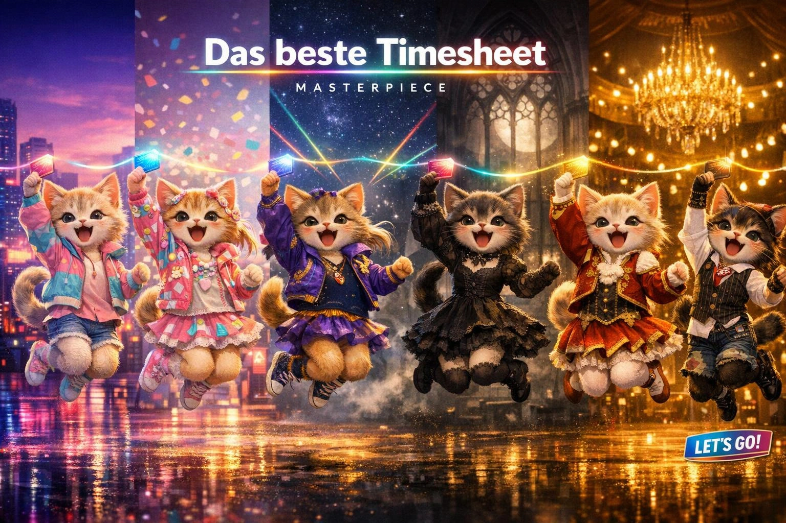

Der Song **Das beste Timesheet – 7,8** ist eine augenzwinkernde Stadion-Hymne auf eines der unscheinbarsten, aber wichtigsten Rituale im Forschungs- und Büroalltag: die **monatliche Zeiterfassung** in SAP CATS. 

Was sonst als trockene Pflichtaufgabe gilt, wird hier mit maximalem Pathos, großen Melodien und einer ordentlichen Portion Selbstironie als das größte Tageswerk gefeiert.

---

### Humor & Einordnung (Kein Grund zur Sorge)

Dieser Song ist ein **privates, liebevolles Spaß-Projekt** aus dem ganz normalen Arbeitsalltag zwischen Forschung und Projektverwaltung:

* **Ironische Selbstmotivation:** Wenn im Text von einem *„Masterpiece“* oder einer *„legendären“* Leistung die Rede ist, dann ist das bewusst maßlos übertrieben. Jeder, der schon einmal krumme Projektstunden so über Tage und PSP-Elemente gepuzzelt hat, dass an jedem Vollzeittag exakt **7,8 Stunden** stehen, kennt dieses kleine Triumphgefühl, wenn endlich alles aufgeht.

* **Wertschätzung statt Kritik:** Der Song richtet sich gegen niemanden – im Gegenteil: Er feiert die gute Zusammenarbeit zwischen Forschung und Zeitwirtschaft und hält den Arbeitsalltag mit einem Augenzwinkern zusammen.

---

### Inspiration & Produktion (100 % lokal mit ACE-Step & ComfyUI)

*Das beste Timesheet – 7,8* wurde **vollständig lokal auf dem eigenen Rechner mit ACE-Step in ComfyUI** gerendert.

* **Entstehung & Vorgeschichte:** Die Tradition begann vor über einem Jahr mit den monatlichen Kätzchen-Bildern für unsere CATS-Erinnerungsmails. Anfang 2026 entdeckte ich dann **ACE-Step in ComfyUI** für mich und spielte viel damit. Der allererste musikalische Versuch zur Zeiterfassung war noch ein [➜ kurzes, vertontes Gedicht](styles/prototyp.md). Parallel dazu arbeitete ich an einem anderen Song-Projekt und konnte alles, was ich dabei über Arrangement, Phonetik und Workflows gelernt habe, direkt hier anwenden – so wuchs aus der kleinen Idee schließlich dieses ausgewachsene Spaß-Projekt.

* **KI-gestützter Workflow:** Songtext, Struktur und Prompts wurden in einem iterativen Dialog mit Google Gemini verfeinert, bis Reimfluss, Rhythmus und die Phonetik von Fachbegriffen wie *SAP CATS* oder *PSP-Element* perfekt saßen.

* **Modulare ComfyUI-Workflows:** Um alles schlank und performant zu halten, besitzt jede der Stilrichtungen einen **eigenen ComfyUI-Workflow mit anpassbaren Subgraphs**. Die einzelnen Track-Varianten entstehen durch Variation der Parameter und lassen sich per Drag-and-Drop der MP3-Dateien direkt wieder in ComfyUI laden.

* **Cover-Art & das *CATS*-Wortspiel:** Passend zum Namen des Zeiterfassungssystems **SAP CATS** zeigen die Cover-Arts – genau wie die monatlichen Erinnerungs-E-Mails an die Zeiterfassung – **Kätzchen**. Generiert wurden die Bilder hier mit **GPT-Image** - in den Erinnerungs-E-Mails zuvor oft mit den Modellen *CyberRealistic v9.0* und *False Reality Mix v2.0*.

---

## Songtext, Musikrichtungen & Workflows

* **Songtext: *Das beste Timesheet – 7,8*** – *Auf drei Ebenen aufbereitet:*
  * [➜ Formatierter Songtext](lyrics/lyrics_format.md) – *Pur zum Lesen und Mitsingen.*
  * [➜ Songtext mit Interpretation](lyrics/lyrics_meaning.md) – *Alle Insider rund um 7,8 Stunden, SAP CATS, usw.*
  * [➜ Songtext als Prompt](lyrics/lyrics_prompt.md) – *Die phonetisch angepasste Version für die Audio-Generierung.*

* [➜ Musikrichtungen](styles/styles.md) – *Alle Stile, Cover und Workflows.*

---

## Lizenz, Urheberrecht & Markenhinweise

### 1. Eigene Texte, Prompts & Workflows

Alle von mir verfassten sowie mithilfe von KI-Werkzeugen ausgearbeiteten Songtexte, Style-/Image-Prompts und ComfyUI-Workflows stammen von **Sebastian Rostock** und stehen – soweit urheberrechtlich schutzfähig – unter der [Creative Commons BY-NC-SA 4.0](LICENSE)-Lizenz.

* **Community & Kollegen:** Ihr dürft den Song, die Texte und den ComfyUI-Workflow im Rahmen nicht-kommerzieller Projekte, interner Präsentationen oder Streams gerne teilen und nutzen. Eine kurze Namensnennung freut mich.

* **Verboten:** Der kommerzielle Weiterverkauf der Songs, Texte oder Workflows ist untersagt.

### 2. Hinweis zu Audio- & Bild-Generierung (KI)

* **Musik & Audio:** Die Tracks wurden lokal mit dem Open-Source-Modell **ACE-Step** über **ComfyUI** generiert.

* **Bilder:** Die Cover-Arts wurden mithilfe von **GPT-Image** erstellt.

### 3. Marken- und Namensrechte (*Fraunhofer* & *SAP*)

Dies ist ein **rein privates, nicht-kommerzielles Fan- und Spaß-Projekt** eines Mitarbeiters und stellt keine offizielle Veröffentlichung oder Stellungnahme der genannten Organisationen dar. Alle Rechte an den Marken und Bezeichnungen **Fraunhofer** (Fraunhofer-Gesellschaft zur Förderung der angewandten Forschung e.V.) sowie **SAP** / **SAP CATS** liegen vollständig bei den jeweiligen Rechteinhabern.
