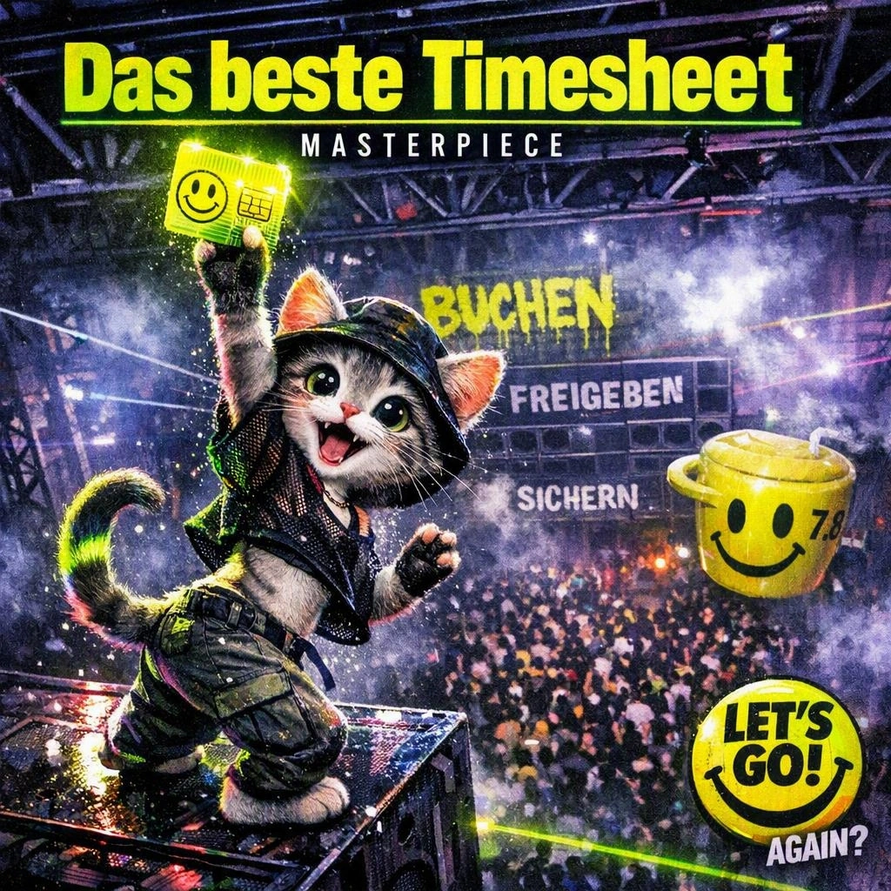

# *Acid* (Musikrichtung zu *Das beste Timesheet – 7,8*) 

#### Tracks & Workflow

* [➜ Track 1 anhören](../audio/acid_1.mp3)
* [➜ Track 2 anhören](../audio/acid_2.mp3)
* [➜ Track 3 anhören](../audio/acid_3.mp3)
* [➜ Track 4 anhören](../audio/acid_4.mp3)
* [➜ ComfyUI-Workflow](../workflows/acid.json)

#### Genre-Cover & Bild-Prompt



```text
SCENE: An extreme wide, high-angle 4am shot from atop a towering speaker stack in a derelict warehouse, camera positioned high and far back among the girders. Square 1:1 acid house 12" sleeve, photorealistic cinematic still, late-1980s rave aesthetic, shot on 24mm, wide and slightly distorted, hard strobe-lit foreground, heavy grain, chromatic fringing. Steel girders, strobe-lit smoke, walls of stacked speaker cabinets, a heaving crowd of silhouettes far below.
A photorealistic small anthropomorphic kitten girl — petite and youthful, rounded fluffy kitten head with anatomically believable structure, large oversized ears with soft inner fur tufts and backlit translucency, very soft plush short brindled fur with visible individual hairs glowing under UV, whiskers catching the strobe, small paws, slender fluffy tail curled upward at the tip with a UV-reactive stripe along its length — stands at the edge of the speaker stack in the lower left corner of the frame, the condensation-slick surface beneath her reflecting the acid glow in realistic specular streaks. She wears an oversized cropped mesh top over a bralette with baggy cargo trousers slung low and a bucket hat pushed back between her ears, slightly too big for her small frame, physically accurate fabric drape. Her body is seen in a three-quarter rear view, mostly from behind and partly from the side, her back and one shoulder turned toward the camera. Her head is turned back over her shoulder toward the camera in a charming three-quarter view, both large bright eyes catching the light, pupils wide, muzzle and cheek fully visible, mouth open in a delighted open-mouthed cheer, whiskers fanned, a joyful squint. She is posed in pure delirious excitement — mid-leap on tiptoes, back arched, ears perked straight up, tail whipping upward in an energetic curl, tiny droplets of sweat and condensation flung off her fur by the motion and caught in crisp motion-frozen detail. Her RIGHT arm is stretched fully vertical above her head, presenting a SMARTCARD heroically aloft in her paw like a trophy — an acid-yellow card with a printed smiley chip and glowing lime-green circuit traces, blindingly lit from within, casting hard practical light on her paw, forearm, jawline and the smoke around it. Her LEFT arm lags behind, bent at the elbow at roughly half height, paw open and empty, clearly on its way up to join the cheer — an asymmetric, playful gesture.
Palette: acid yellow, hot lime green, magenta, UV violet, black; blown highlights, no warm practicals. Spray-painted wall lettering and a stretched banner spell out a three-step sequence, staggered in depth from near to far: "BUCHEN" largest and closest sprayed in dripping acid yellow on raw concrete, "FREIGEBEN" mid-distance stencilled across a speaker stack, "SICHERN" smallest and deepest, warping through the smoke at the back wall. Bulbous bubble-graffiti caps with hard outlines and drips, each partially occluded by smoke, girders and laser planes.
Mid-ground center-right: a giant glowing DJ mixer panel sitting on the main stage; its retro-illuminated vertical volume meters and digital BPM counter clearly display the numerals "7.8" in hyper-bright, blindingly white-hot characters.
Typography composited cleanly over the image: large title "Das beste Timesheet" across the top, chunky rave-flyer sans with a hard black outline, acid yellow with green glow. Below it, smaller subtitle "Masterpiece" in thin letterspaced caps. Bottom-right: a slightly tilted smiley-badge "LET'S GO!" in bold caps, and just beneath it, smaller and semi-transparent, "AGAIN?".
Mood: delirious, overloaded, peak-time euphoria. Strobe-lit, blown highlights, saturated cold-plus-acid grade, zero warmth.
```

---

Zurück zur [➜ Übersicht der Musikrichtungen](styles.md) oder zurück zum [➜ Hauptdokument](../README.md).
