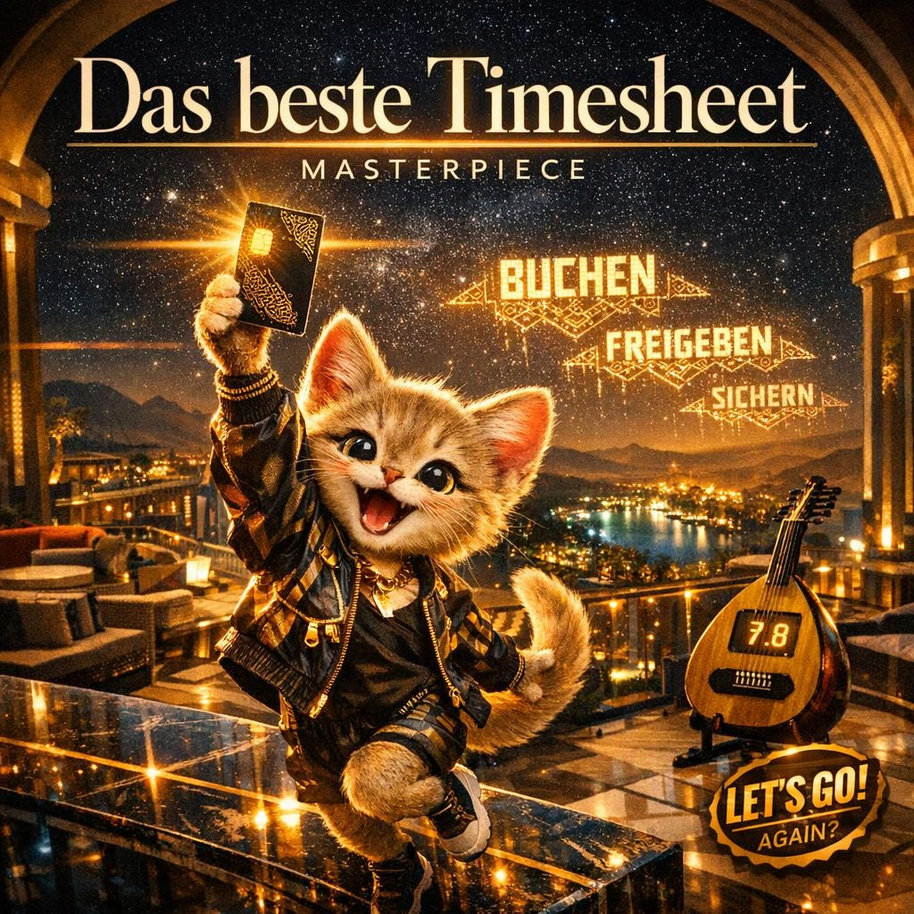

# *Arabian Trap* (Musikrichtung zu *Das beste Timesheet – 7,8*) 
 
#### Tracks & Workflow

[➜ Track 1 anhören](../audio/arabian_trap_1.mp3)
[➜ Track 2 anhören](../audio/arabian_trap_2.mp3)

[➜ ComfyUI-Workflow](../workflows/arabian_trap.json)

#### Genre-Cover & Bild-Prompt



```text
SCENE: An extreme wide, high-angle shot from the high arches of a luxurious, ultra-modern Middle Eastern desert lounge overlooking a starlit oasis at night, camera positioned high and far back. Square 1:1 modern arabic pop single cover, photorealistic cinematic still, high-energy trap fusion aesthetic, shot on 35mm, crisp anamorphic horizontal golden flares, sharp contrast, fine film grain. Plush velvet seating areas, geometric marble floors, and glass-walled terraces overlooking sand dunes far below.
A photorealistic small anthropomorphic kitten girl — petite and youthful, rounded fluffy kitten head with anatomically believable structure, large oversized ears with soft inner fur tufts catching the warm light, very soft plush short sand-colored fur — stands on top of a polished black marble balustrade in the lower left corner of the frame, the mirror-clear surface beneath her reflecting the ambient lights in sharp specular streaks. She wears a slick, high-energy modern streetwear outfit featuring an oversized silk bomber jacket with golden geometric embroidery, tech-wear straps, and modern gold jewelry charms attached to her collar, physically accurate fabric drape. Her body is seen in a three-quarter rear view from behind. Her head is turned back over her shoulder toward the camera in a charming three-quarter view, both large expressive eyes catching the light, mouth open in a charismatic, playful shouting cheer, whiskers fanned, a joyful squint. She is posed in pure euphoric excitement — mid-leap on tiptoes with a sharp, bouncy trap-dance energy, back arched, ears perked straight up, tail whipping upward in an energetic curl, a subtle shimmer of golden glitter particles caught in her fur by the motion. Her RIGHT arm is stretched fully vertical above her head, presenting a SMARTCARD heroically aloft in her paw like a rare key — an opulent matte-black card with intricate gold Maqam-pattern filigree and a blindingly bright amber-glowing electronic chip, casting hard practical light on her paw, forearm, jawline, and the surrounding night air. Her LEFT arm lags behind, bent at the elbow at half height, paw open.
Palette: modern luxury pop — deep midnight indigo shadows, vibrant gold, rich amber, sand-warm horizon glow, sharp turquoise accents. Glowing holographic Arabic-inspired geometric light projections on the far palace walls spell out a three-step sequence, staggered in depth from near to far: "BUCHEN" largest and closest, "FREIGEBEN" mid-distance, "SICHERN" smallest and deepest toward the desert haze. Sharp, condensed geometric caps with subtle calligraphic lines.
Mid-ground center-right: a beautifully crafted, modern electronic Oud instrument resting on a stand; its digital tuning display screen embedded in the wood clearly displays the numerals "7.8" in crisp, luminous gold vector characters.
Typography composited cleanly over the image: large title "Das beste Timesheet" across the top, modern sharp serif with fine hairlines, ivory white with a rich gold outer glow. Below it, smaller subtitle "Masterpiece" in thin letterspaced caps. Bottom-right: a slightly tilted golden-seal style badge "LET'S GO!" in bold caps, and just beneath it, smaller and semi-transparent, "AGAIN?".
Mood: charismatic, playful, high-energy desert luxury euphoria. Vibrant amber bloom, sharp modern contrast, polished high-gloss pop grade.
```

---

Zurück zur [➜ Übersicht der Musikrichtungen](styles.md) oder zurück zum [➜ Hauptdokument](../README.md).
