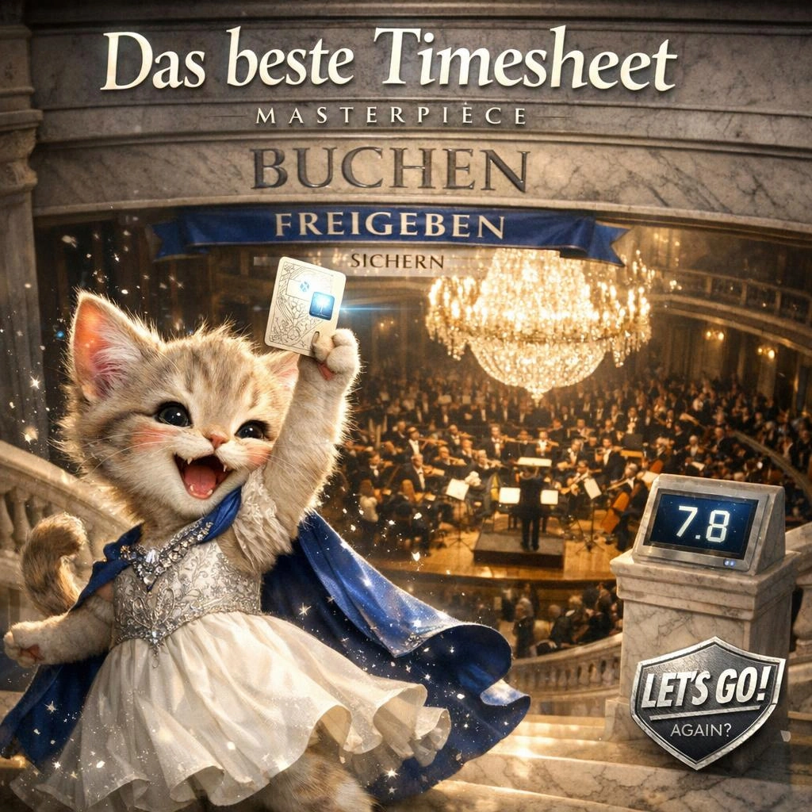

## Cinematic Pop

#### Tracks & Workflow

* [➜ Track 1 anhören](../audio/cinematic_pop_1.mp3)
* [➜ Track 2 anhören](../audio/cinematic_pop_2.mp3)
* [➜ ComfyUI_Workflow](../workflows/cinematic_pop.json)

#### Genre-Cover & Bild-Prompt



```text
Square 1:1 orchestral crossover album cover, photorealistic cinematic still, epic aesthetic, shot on 70mm, clean anamorphic flare, fine grain.
SCENE: High-angle wide shot from the top of a grand marble staircase in a vast concert hall. A full orchestra far below mid-crescendo, a crystal chandelier blazing above.
The kitten girl is large in the lower-left foreground, filling about 40% of the frame height, sharp and close to camera: a photorealistic small anthropomorphic kitten girl, petite and youthful, rounded fluffy kitten head, large backlit ears with soft inner tufts, plush pale brindled fur. Oversized white gown with a silver-embroidered bodice and sapphire-blue cape. Three-quarter rear view, head turned back toward the camera, delighted open-mouthed cheer, joyful squint. Mid-leap on tiptoes, ears perked, tail curled upward, silver motes around her. Right arm straight up holding an ivory SMARTCARD with silver engraving and a glowing blue-white chip; left arm bent at half height.
Palette: ivory, sapphire blue, silver, crystal white.
Lettering, near to far: "BUCHEN" largest in a marble lintel in silver relief, "FREIGEBEN" on a sapphire banner, "SICHERN" smallest on the proscenium arch. Roman inscriptional caps.
Mid-ground right: a marble podium terminal whose screen shows "7.8" in crisp silver-blue.
Typography: title "Das beste Timesheet" at top, classical serif, ivory with soft blue glow; subtitle "Masterpiece" in thin letterspaced caps; bottom-right tilted silver-foil crest badge "LET'S GO!", beneath it small semi-transparent "AGAIN?".
Mood: majestic, triumphant standing-ovation joy, crystal bloom.
Spell all text exactly as written, no additional text.
```

---

Zurück zur [➜ Übersicht der Musikrichtungen](styles.md) oder zurück zum [➜ Hauptdokument](../README.md).
