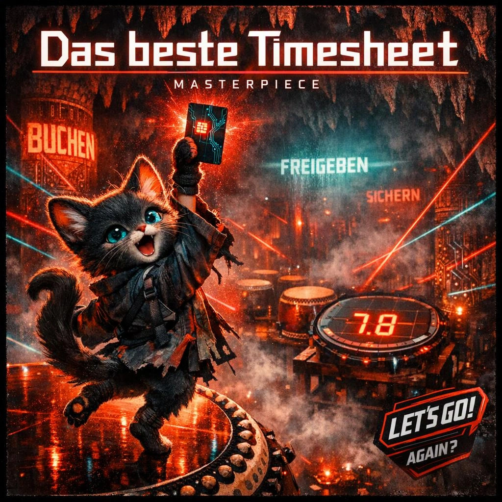

# *Cyber-Tribal* (Musikrichtung zu *Das beste Timesheet – 7,8*) 
 
#### Tracks & Workflow

[➜ Track 1 anhören](../audio/cyber_tribal_1.mp3)
[➜ Track 2 anhören](../audio/cyber_tribal_2.mp3)
[➜ Track 3 anhören](../audio/cyber_tribal_3.mp3)
[➜ Track 4 anhören](../audio/cyber_tribal_4.mp3)

[➜ ComfyUI_Workflow](../workflows/cyber_tribal.json)

#### Genre-Cover & Bild-Prompt



```text
SCENE: An extreme wide, high-angle shot from the high bamboo scaffolding inside a hidden, subterranean cyberpunk temple cave, camera positioned high and far back beneath ancient stone stalactites. Square 1:1 anime soundtrack cover, photorealistic cinematic still, experimental cyber-tribal aesthetic, shot on 35mm, sharp contrast, intense red and teal laser patterns, fine film grain. Massive traditional Japanese Taiko drums arranged on sub-bass speaker stacks far below, columns carved with glowing circuit traces, a dense haze of ritualistic smoke.
A photorealistic small anthropomorphic kitten girl — petite and youthful, rounded fluffy kitten head with anatomically believable structure, large oversized ears with soft inner fur tufts, very soft plush short charcoal-black fur catching the harsh light — stands on the rim of a gigantic ceremonial drum shell in the lower left corner of the frame, the polished lacquer surface beneath her reflecting the intense laser drops in sharp specular streaks. She wears an oversized ritualistic cyber-kimono jacket with tattered hems and heavy tech-wear combat straps, slightly too big for her small frame, physically accurate fabric drape. Her body is seen in a three-quarter rear view from behind. Her head is turned back over her shoulder toward the camera in a charming three-quarter view, both large bright neon-teal eyes catching the light, mouth open in a haunting, ritualistic non-lexical chanting cheer, whiskers fanned, a joyful squint. She is posed in pure euphoric, ritualistic excitement — mid-leap on tiptoes with an intense, tribal-dance energy, back arched, ears perked straight up, tail whipping upward in an energetic curl, a cloud of ancient temple dust and static sparks caught in her fur by the motion. Her RIGHT arm is stretched fully vertical above her head, presenting a SMARTCARD heroically aloft in her paw like a sacred tribal relic — a heavy obsidian card with glowing teal circuit paths and a blindingly bright neon-red glowing chip, casting hard practical light on her paw, forearm, jawline, and the surrounding smoke. Her LEFT arm lags behind, bent at the elbow at half height, paw open.
Palette: haunting cyberpunk — deep shadow blacks, intense crimson red, neon teal, high-voltage laser lines, atmospheric temple smoke. Massive glowing neon glyphs on the cave walls spell out a three-step sequence, staggered in depth from near to far: "BUCHEN" largest and closest carved into a stone pillar, "FREIGEBEN" mid-distance floating as a projection, "SICHERN" smallest and deepest in the heavy background haze. Sharp, aggressive geometric caps.
Mid-ground center-right: a large traditional electronic ritual drum pad resting on a wooden stand; its central digital level meter screen clearly displays the beat numerals "7.8" in sharp, luminous neon-red vector lines.
Typography composited cleanly over the image: large title "Das beste Timesheet" across the top, aggressive cyber-geometric sans-serif, bright white with a sharp red outer glow. Below it, smaller subtitle "Masterpiece" in thin letterspaced caps. Bottom-right: a slightly tilted cyber-crest badge "LET'S GO!" in bold caps, and just beneath it, smaller and semi-transparent, "AGAIN?".
Mood: haunting, ritualistic, melancholic yet ecstatic night euphoria. Intense laser bloom, deep contrast, polished cyber-anime grade.
```

---

Zurück zur [➜ Übersicht der Musikrichtungen](styles.md) oder zurück zum [➜ Hauptdokument](../README.md).
