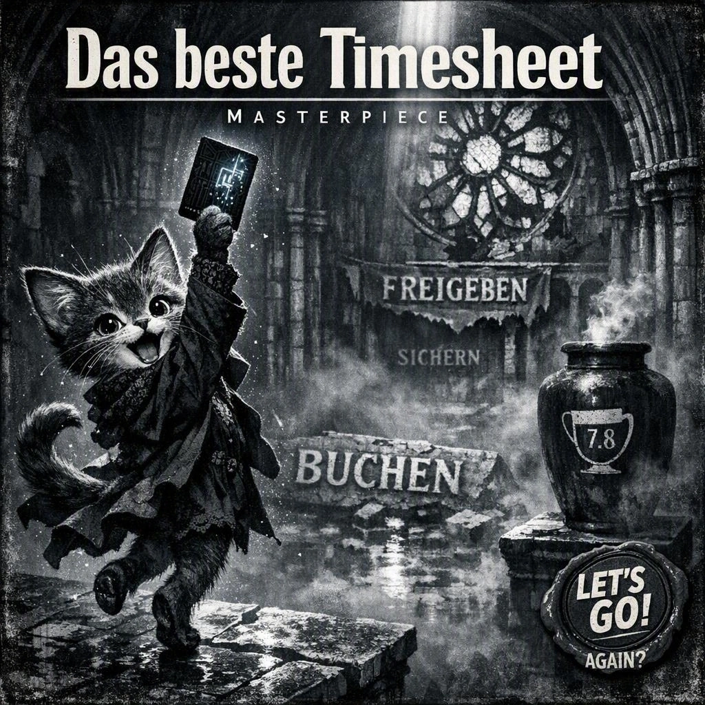

## Darkwave-Goth

#### Tracks & Workflow

* [➜ Track 1 anhören](../audio/darkwave_goth_1.mp3)
* [➜ Track 2 anhören](../audio/darkwave_goth_2.mp3)
* [➜ Track 3 anhören](../audio/darkwave_goth_3.mp3)
* [➜ Track 4 anhören](../audio/darkwave_goth_4.mp3)
* [➜ ComfyUI_Workflow](../workflows/darkwave_goth.json)

#### Genre-Cover & Bild-Prompt



```text
Square 1:1 darkwave 12" sleeve, photorealistic cinematic still, 1980s post-punk gothic aesthetic, shot on 28mm, heavy grain, near-monochrome with one cold accent.
SCENE: High-angle wide night shot from a stone gallery inside a derelict cathedral. Shattered rose window, fog on broken flagstones far below, a shaft of moonlight.
The kitten girl is large in the lower-left foreground, filling about 40% of the frame height, sharp and close to camera: a photorealistic small anthropomorphic kitten girl, petite and youthful, rounded fluffy kitten head, large backlit ears with soft inner tufts, plush dark brindled fur. Oversized high-collared black lace blouse under a long coat, standing on rain-wet stone. Three-quarter rear view, head turned back toward the camera, bright eyes, delighted open-mouthed cheer, joyful squint; her pure cheerful joy deliberately contrasts with the austere setting. Mid-leap on tiptoes, ears perked, tail curled upward, drizzle flung from her fur. Right arm straight up holding a matte-black SMARTCARD with an ice-blue glowing trace, the only color accent; left arm bent at half height.
Palette: charcoal, bone white, ash grey, one accent of ice-blue.
Lettering, near to far: "BUCHEN" largest carved into a fallen slab, "FREIGEBEN" on a tattered banner between columns, "SICHERN" smallest in the fog at the apse. Condensed engraved caps.
Mid-ground right: a gargoyle beside a digital station clock showing "7.8" in ice-blue LCD segments.
Typography: title "Das beste Timesheet" at top, stark condensed sans, bone white with cold halo; subtitle "Masterpiece" in thin letterspaced caps; bottom-right tilted wax-seal badge "LET'S GO!", beneath it small semi-transparent "AGAIN?".
Mood: solemn cathedral, bright joyful heroine, cold moonlight, heavy vignette.
Spell all text exactly as written, no additional text.
```

---

Zurück zur [➜ Übersicht der Musikrichtungen](styles.md) oder zurück zum [➜ Hauptdokument](../README.md).
