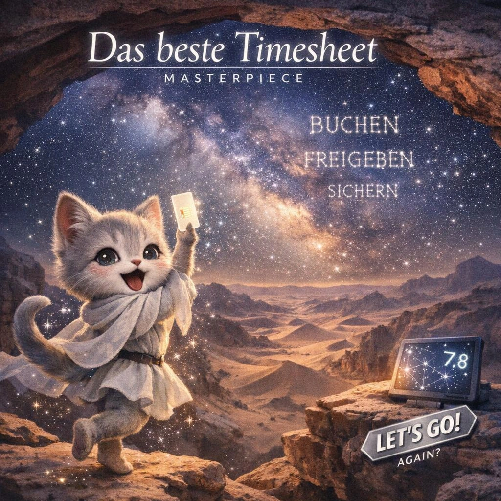

# *Desert Dream Pop* (Musikrichtung zu *Das beste Timesheet – 7,8*) 
 
#### Tracks & Workflow

[➜ Track 1 anhören](../audio/desert_dream_pop_1.mp3)
[➜ Track 2 anhören](../audio/desert_dream_pop_2.mp3)
[➜ Track 3 anhören](../audio/desert_dream_pop_3.mp3)
[➜ Track 4 anhören](../audio/desert_dream_pop_4.mp3)

[➜ ComfyUI_Workflow](../workflows/desert_dream_pop.json)

#### Genre-Cover & Bild-Prompt



```text
SCENE: An extreme wide, high-angle shot from a high rocky plateau overlooking a vast, dreamlike desert canyon under a breathtaking starry night sky, camera positioned high and far back beneath a natural stone arch. Square 1:1 ambient dream-pop single cover, photorealistic cinematic still, mystical starlit desert aesthetic, shot on 35mm, soft ethereal lens flares, gentle light bloom, fine vintage film grain. An endless sea of smooth desert dunes stretching to the horizon beneath a massive, glowing Milky Way galaxy.
A photorealistic small anthropomorphic kitten girl — petite and youthful, rounded fluffy kitten head with anatomically believable structure, large oversized ears with soft inner fur tufts, very soft plush short silver-cream fur catching the starlight — stands at the absolute edge of the rocky cliff in the lower left corner of the frame, the wind-swept sandstone beneath her catching the faint celestial glow in soft specular textures. She wears an oversized, flowing gossamer-thin linen shawl over a simple cotton tunic, the fabric catching the gentle desert breeze and draping gracefully around her small frame. Her body is seen in a three-quarter rear view from behind. Her head is turned back over her shoulder toward the camera in a charming three-quarter view, large deep eyes reflecting the starlight, mouth open in a seductive, mystical, deeply emotional open-mouthed singing cheer, whiskers fanned, a joyful squint. She is posed in pure euphoric, dreamlike excitement — mid-leap on tiptoes as if floating, back arched, ears perked straight up, tail whipping upward in an elegant curl, a faint cloud of glittering stardust particles flung off her fur by the motion. Her RIGHT arm is stretched fully vertical above her head, presenting a SMARTCARD heroically aloft in her paw like a mystical relic — a beautiful translucent pearl-white card with faint silver engravings and a softly glowing starlight-white chip, casting a gentle, mystical practical light on her paw, forearm, and face. Her LEFT arm lags behind, bent gracefully at the elbow at half height.
Palette: mystical starlit desert — deep celestial indigo, shimmering silver, soft cosmic violet, warm amber sand accents, ethereal starlight highlights against soft shadows. Constellations in the night sky align perfectly to form glowing cosmic letters that spell out a three-step sequence, staggered in depth from near to far across the galaxy: "BUCHEN" closest, "FREIGEBEN" mid-distance, "SICHERN" deepest in the cosmic haze. Thin, elegant modern caps.
Mid-ground center-right: on a nearby flat stone altar, an ancient ornate brass astrolabe instrument; its rotating mechanical wheels align precisely to show the numerals "7.8" engraved on its central ring, catching a stray beam of moonlight.
Typography composited cleanly over the image: large title "Das beste Timesheet" across the top, elegant classical serif with fine hairlines, crisp white with a subtle starlight-white outer glow. Below it, smaller subtitle "Masterpiece" in thin, wide letterspaced caps. Bottom-right: a slightly tilted matte-stamped silver badge "LET'S GO!" in bold caps, and just beneath it, smaller and semi-transparent, "AGAIN?".
Mood: mystical, seductive, serene desert euphoria. Soft celestial bloom, deep atmospheric shadows, comforting cool-tone grade.
```

---

Zurück zur [➜ Übersicht der Musikrichtungen](styles.md) oder zurück zum [➜ Hauptdokument](../README.md).
