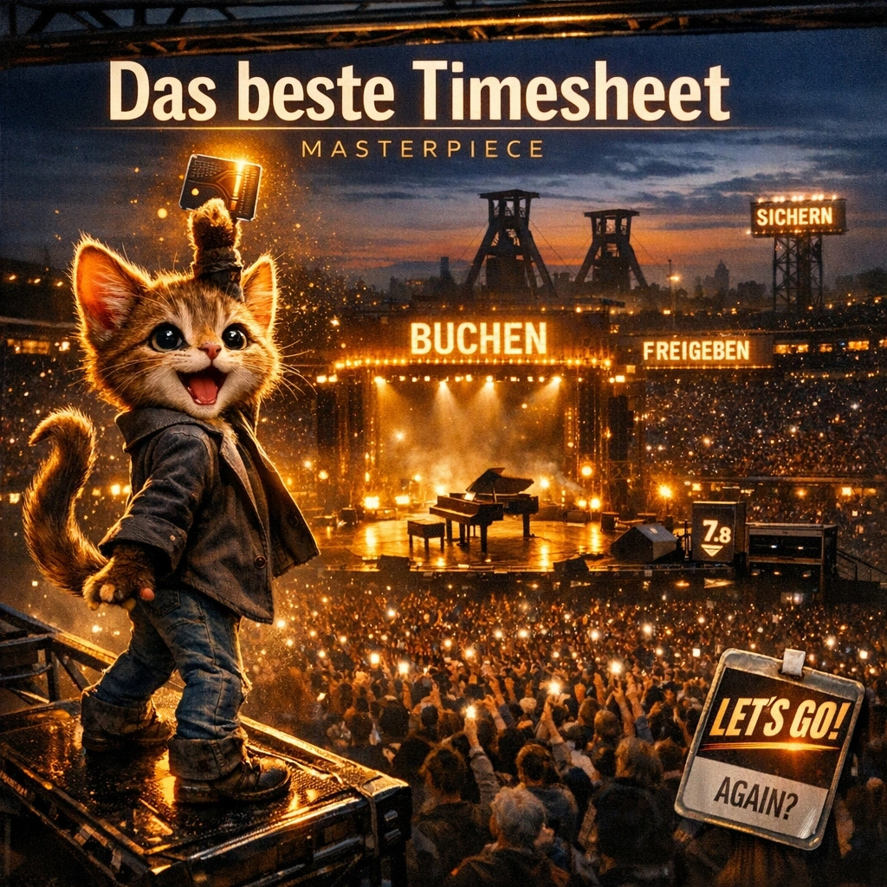

## Deutschpop-Rock

#### Tracks & Workflow

* [➜ Track 1 anhören](../audio/deutschpop_rock_1.mp3)
* [➜ Track 2 anhören](../audio/deutschpop_rock_2.mp3)
* [➜ Track 3 anhören](../audio/deutschpop_rock_3.mp3)
* [➜ ComfyUI-Workflow](../workflows/deutschpop_rock.json)

#### Genre-Cover & Bild-Prompt



````text
SCENE: An extreme wide, high-angle twilight shot across the interior of a packed open-air stadium arena in an industrial Ruhr-area setting, camera positioned high and far back on a steel lighting catwalk above the main stage. Square 1:1 2000s German pop-rock 12" album sleeve, photorealistic cinematic still, warm emotional stadium-concert aesthetic, shot on 35mm, natural anamorphic horizontal lens flares, fine film grain. Distant illuminated coal-mine winding towers silhouetted against a deep blue-hour sky on the horizon, a polished black grand concert piano at center stage below surrounded by warm amber spotlights, subtle stage haze, coiled stage monitors, and a vast sea of glowing smartphone lights and raised hands across the stadium crowd far below.
A photorealistic small anthropomorphic kitten girl — petite and youthful, rounded fluffy kitten head with anatomically believable structure, large oversized ears with soft inner fur tufts and backlit translucency, very soft plush short warm chestnut-brindled fur with visible individual hairs, whiskers catching the warm spotlight, small paws, slender fluffy tail curled upward at the tip — stands ON the edge of a steel stage monitor truss in the lower left corner of the frame, high above the crowd, the rain-slicked dark metal surface beneath her reflecting the amber stage glare in realistic specular streaks. She wears an oversized charcoal-grey vintage blazer with pushed-up sleeves over a dark crewneck shirt, worn blue jeans and scuffed boots, slightly too big for her small frame, physically accurate fabric drape. Her body is seen in a three-quarter rear view, mostly from behind and partly from the side, her back and one shoulder turned toward the camera, the blazer catching the warm rim light. Her head is turned back over her shoulder toward the camera in a charming three-quarter view, both large bright eyes glistening with emotion, muzzle and cheek fully visible, mouth open in a delighted, heartfelt singing cheer, whiskers fanned, a joyful squint. She is posed in pure anthemic euphoria — mid-leap on tiptoes, back arched, ears perked straight up, tail whipping upward in an energetic curl, tiny golden dust motes drifting through the spotlight beams around her. Her RIGHT arm is stretched fully vertical above her head, presenting a SMARTCARD heroically aloft in her paw like a trophy — an anthracite-silver brushed metal card with subtle vinyl-groove etching and a glowing warm-amber circuit trace, lit from within, casting warm practical light on her paw, forearm, jawline and the haze around it. Her LEFT arm lags behind, bent at the elbow at roughly half height, paw open and empty, clearly on its way up to join the cheer — an asymmetric, joyful gesture.
Palette: deep twilight blue, warm amber spotlight gold, steel grey, coal black, ivory highlights; rich cinematic contrast, warm emotional glow against cool evening shadows. Stage LED screens and stadium banners spell out a three-step sequence, staggered in depth from near to far: "BUCHEN" largest and closest in warm amber-white LED letters on the main stage header, "FREIGEBEN" mid-distance across a glowing stadium ribbon board, "SICHERN" smallest and deepest on a distant floodlight tower in the twilight haze. Clean, bold humanist sans-serif caps, each partially framed by lighting trusses, haze and stadium rigging.
Mid-ground center-right: the polished black grand concert piano beside a digital stage-monitor console whose illuminated screen displays a minimalist coffee-cup icon and the numerals "7.8" clearly in warm amber LED digits.
Typography composited cleanly over the image: large title "Das beste Timesheet" across the top, bold clean 2000s German rock sans-serif, crisp ivory white with a warm amber-gold glow. Below it, smaller subtitle "Masterpiece" in thin letterspaced caps. Bottom-right: a slightly tilted laminated backstage-pass badge "LET'S GO!" in bold italic caps, and just beneath it, smaller and semi-transparent, "AGAIN?".
Mood: anthemic, heartfelt, melancholic yet optimistic stadium euphoria, honest working-class warmth. Rich warm-and-cool cinematic grade.
German pop rock, male vocals, raspy emotional voice, piano driven, driving bassline, driving drums, anthemic chorus, melancholic yet optimistic, 2000s deutschpop, articulate German lyrics, energetic. Herbert Grönemeyer style.
````

---

Zurück zur [➜ Übersicht der Musikrichtungen](styles.md) oder zurück zum [➜ Hauptdokument](../README.md).
