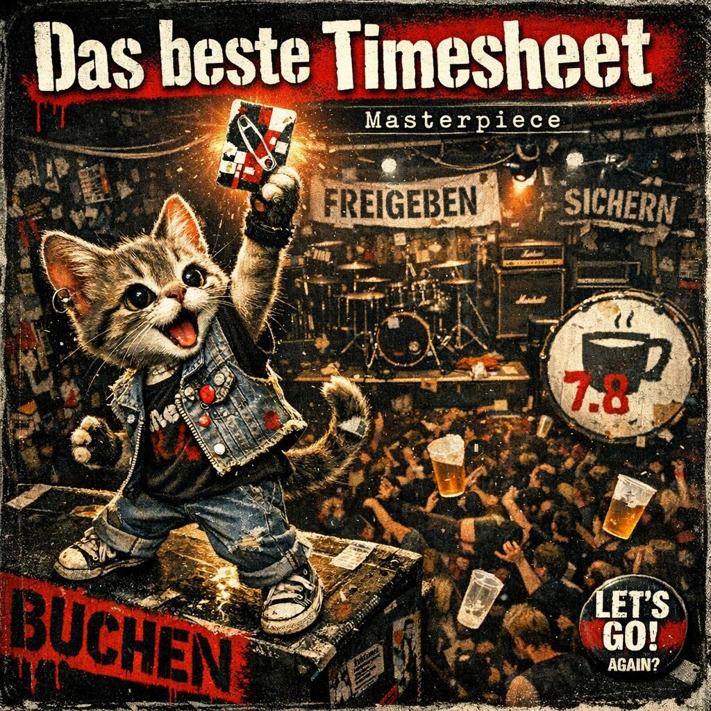

# *Deutschpunk* (Musikrichtung zu *Das beste Timesheet – 7,8*) 

#### Tracks & Workflow

* [➜ Track 1 anhören](../audio/deutschpunk_1.mp3)
* [➜ Track 2 anhören](../audio/deutschpunk_2.mp3)
* [➜ Track 3 anhören](../audio/deutschpunk_3.mp3)
* [➜ Track 4 anhören](../audio/deutschpunk_4.mp3)
* [➜ ComfyUI-Workflow](../workflows/deutschpunk.json)

#### Genre-Cover & Bild-Prompt



```text
SCENE: An extreme wide, high-angle night shot across the interior of a packed autonomous youth-centre club ("Jugendzentrum"), camera positioned high and far back on a steel catwalk above the PA. Square 1:1 Deutschpunk 12" sleeve, photorealistic cinematic still, 90s pop-punk / German punk aesthetic, shot on 28mm, wide and slightly distorted, hard on-camera flash feel, heavy grain, cheap-xerox contrast. Sticker-plastered walls and flyposter collage, a low stage with a battered Marshall wall and a taped-up drum riser below, duct-taped cables, a crowd-surfing mosh pit of silhouettes far below, beer cups mid-air.
A photorealistic small anthropomorphic kitten girl — petite and youthful, rounded fluffy kitten head with anatomically believable structure, large oversized ears with soft inner fur tufts and backlit translucency, very soft plush short brindled fur with visible individual hairs, one ear with a tiny safety-pin earring, whiskers catching the flash, small paws, slender fluffy tail curled upward at the tip with a small strip of chequered tape near the tip — stands ON the edge of a stacked PA cabinet in the lower left corner of the frame, above the pit, the beer-slicked gaffer-taped surface beneath her reflecting the stage glare in realistic specular streaks. She wears an oversized band tee under a battered studded denim vest covered in patches and badges, baggy rolled-up jeans and scuffed sneakers, slightly too big for her small frame, physically accurate fabric drape. Her body is seen in a three-quarter rear view, mostly from behind and partly from the side, her back and one shoulder turned toward the camera, the vest's painted back-patch catching the light. Her head is turned back over her shoulder toward the camera in a charming three-quarter view, both large bright eyes catching the light, muzzle and cheek fully visible, mouth open in a delighted open-mouthed cheer mid-shout, whiskers fanned, a joyful squint. She is posed in pure euphoric excitement — mid-leap on tiptoes, back arched, ears perked straight up, tail whipping upward in an energetic curl, tiny droplets of beer and sweat flung off her fur by the motion and caught in crisp motion-frozen detail. Her RIGHT arm is stretched fully vertical above her head, presenting a SMARTCARD heroically aloft in her paw like a trophy — a sticker-collaged card with torn flyer edges, safety-pin motif and a glowing red-and-white circuit trace, lit from within, casting hard practical light on her paw, forearm, jawline and the haze around it. Her LEFT arm lags behind, bent at the elbow at roughly half height, paw open and empty, clearly on its way up to join the cheer — an asymmetric, playful gesture.
Palette: raw red, bone white, black, dirty denim blue, flyer-paper yellow; blown flash highlights, grimy mid-tones, no soft warmth. Spray-paint and torn flyposter lettering spell out a three-step sequence, staggered in depth from near to far: "BUCHEN" largest and closest stencil-sprayed in dripping red on a PA cabinet, "FREIGEBEN" mid-distance on a hand-painted bedsheet banner above the stage, "SICHERN" smallest and deepest, half-torn in the haze on the back wall. Bold stencil and ransom-note cut-out caps with drips and tape, each partially occluded by cables, stickers and the Marshall stack.
Mid-ground center-right: a huge hand-painted bass drum head turned to camera, white with a crude black coffee-cup motif, the numerals "7.8" sprayed clearly inside in red stencil, edges taped and dented.
Typography composited cleanly over the image: large title "Das beste Timesheet" across the top, chunky punk stencil sans with a hard black outline and photocopy edges, bone white with red glow. Below it, smaller subtitle "Masterpiece" in thin letterspaced caps. Bottom-right: a slightly tilted button-badge "LET'S GO!" in bold caps, and just beneath it, smaller and semi-transparent, "AGAIN?".
Mood: rowdy, fast, gleefully anarchic, three-chord euphoria. Harsh flash light, blown highlights, gritty high-contrast grade.
german punk rock, 90s pop punk, energetic rock, melodic punk, fast drums, overdrive electric guitar, punchy bass, male vocals, fun energetic mood, raw production style
```

---

Zurück zur [➜ Übersicht der Musikrichtungen](styles.md) oder zurück zum [➜ Hauptdokument](../README.md).
