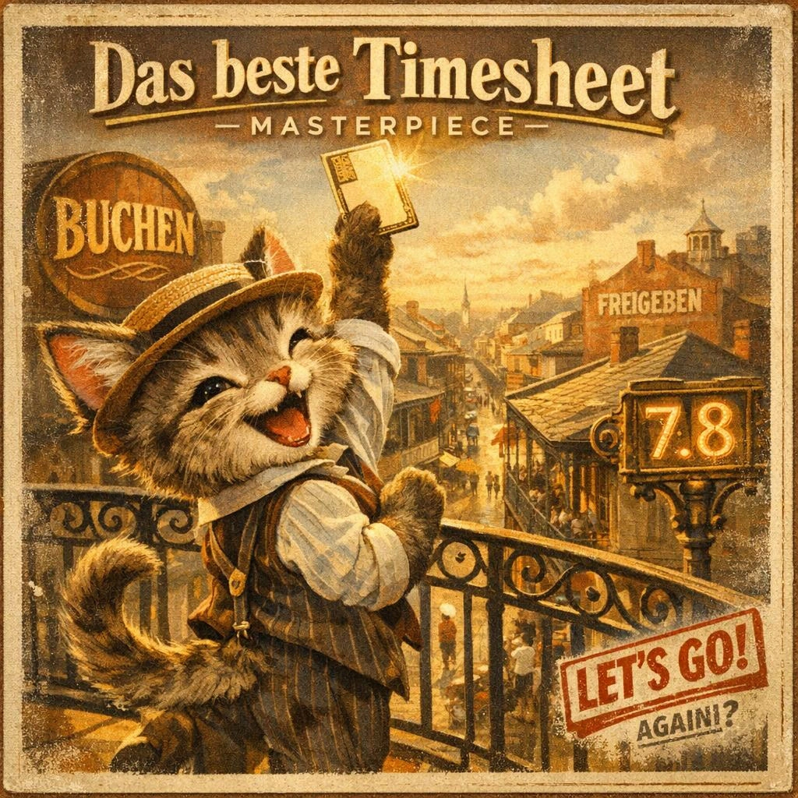

# *Dixieland* (Musikrichtung zu *Das beste Timesheet – 7,8*) 
 
#### Tracks & Workflow

[➜ Track 1 anhören](../audio/dixieland_1.mp3)
[➜ Track 2 anhören](../audio/dixieland_2.mp3)
[➜ Track 3 anhören](../audio/dixieland_3.mp3)
[➜ Track 4 anhören](../audio/dixieland_4.mp3)

[➜ ComfyUI-Workflow](../workflows/dixieland.json)

#### Genre-Cover & Bild-Prompt



```text
SCENE: An extreme wide, high-angle golden-hour shot of a wrought-iron balcony high above a French Quarter street, camera positioned high and far back. Square 1:1 vintage jazz 78rpm record sleeve, photorealistic cinematic still, 1920s New Orleans aesthetic, shot on large-format plate camera, warm halation, heavy paper texture, faded litho print with visible registration offset and foxing at the edges.
A photorealistic small anthropomorphic kitten girl — petite and youthful, rounded fluffy kitten head with anatomically believable structure, large oversized ears with soft inner fur tufts and backlit translucency, very soft plush short brindled fur with visible individual hairs, whiskers catching the low sun, small paws, slender fluffy tail curled upward at the tip — stands at the balcony's edge in the lower left corner of the frame, the rain-wet ironwork and cobblestones below reflecting the warm glow in realistic specular streaks. She wears an oversized pinstripe waistcoat over a rolled-sleeve shirt with suspenders and a straw boater hat pushed back between her ears, slightly too big for her small frame, physically accurate fabric drape. Her body is seen in a three-quarter rear view, mostly from behind and partly from the side, her back and one shoulder turned toward the camera. Her head is turned back over her shoulder toward the camera in a charming three-quarter view, both large bright eyes catching the light, muzzle and cheek fully visible, mouth open in a delighted open-mouthed cheer, whiskers fanned, a joyful squint. She is posed in pure euphoric excitement — mid-leap on tiptoes, back arched, ears perked straight up, tail whipping upward in an energetic curl, tiny droplets flung off her fur by the motion and caught in crisp motion-frozen detail. Her RIGHT arm is stretched fully vertical above her head, presenting a SMARTCARD heroically aloft in her paw like a trophy — a brass-edged cream-coloured card with art-deco engraving and gold-foil detail, catching a hard specular sunbeam that throws warm bounced light onto her paw, forearm and jawline. Her LEFT arm lags behind, bent at the elbow at roughly half height, paw open and empty, clearly on its way up to join the cheer — an asymmetric, playful gesture.
Palette: sepia, brass gold, burnt orange, cream, muted teal awnings, no cool neon. Hand-painted shopfront signage and a hanging banner spell out a three-step sequence, staggered in depth from near to far: "BUCHEN" largest and closest on a barrelhead sign, "FREIGEBEN" mid-distance on a painted brick wall, "SICHERN" smallest and deepest down the street. Fat slab-serif circus lettering with drop shadows and gold leaf, each partially occluded by lanterns and balconies.
Mid-ground center-right: a large enamel diner sign shaped like a coffee cup on a bracket arm, chipped paint, the numerals "7.8" hand-painted inside in cream, steam curling from the painted rim.
Typography composited cleanly over the image: large title "Das beste Timesheet" across the top, fat 1920s slab-serif with inline gold detail, cream with soft brown shadow. Below it, smaller subtitle "Masterpiece" in thin letterspaced caps. Bottom-right: a slightly tilted rubber-stamp badge "LET'S GO!" in bold caps, ink-bled, and just beneath it, smaller and semi-transparent, "AGAIN?".
Mood: jubilant, brassy, end-of-parade celebration. Sunlit, warm grade, gentle bloom, no cool tones. All other buildings noticeably lower than the one in the foreground.
```

```text
SCENE: An extreme wide, high-angle golden-hour shot of a wrought-iron balcony high above a French Quarter street, camera positioned high and far back. Square 1:1 vintage jazz 78rpm record sleeve, photorealistic cinematic still, 1920s New Orleans aesthetic, shot on large-format plate camera, warm halation, heavy paper texture, faded litho print with visible registration offset and foxing at the edges.
A photorealistic small anthropomorphic kitten girl — petite and youthful, rounded fluffy kitten head with anatomically believable structure, large oversized ears with soft inner fur tufts and backlit translucency, very soft plush short brindled fur with visible individual hairs, whiskers catching the low sun, small paws, slender fluffy tail curled upward at the tip — stands at the balcony's edge in the lower left corner of the frame, the rain-wet ironwork and cobblestones below reflecting the warm glow in realistic specular streaks. She wears an oversized pinstripe waistcoat over a rolled-sleeve shirt with suspenders and a straw boater hat pushed back between her ears, slightly too big for her small frame, physically accurate fabric drape. Her body is seen in a three-quarter rear view, mostly from behind and partly from the side, her back and one shoulder turned toward the camera. Her head is turned back over her shoulder toward the camera in a charming three-quarter view, both large bright eyes catching the light, muzzle and cheek fully visible, mouth open in a delighted open-mouthed cheer, whiskers fanned, a joyful squint. She is posed in pure euphoric excitement — mid-leap on tiptoes, back arched, ears perked straight up, tail whipping upward in an energetic curl, tiny droplets flung off her fur by the motion and caught in crisp motion-frozen detail. Her RIGHT arm is stretched fully vertical above her head, presenting a SMARTCARD heroically aloft in her paw like a trophy — a brass-edged cream-coloured card with art-deco engraving and gold-foil detail, catching a hard specular sunbeam that throws warm bounced light onto her paw, forearm and jawline. Her LEFT arm lags behind, bent at the elbow at roughly half height, paw open and empty, clearly on its way up to join the cheer — an asymmetric, playful gesture.
Palette: sepia, brass gold, burnt orange, cream, muted teal awnings, no cool neon. Hand-painted shopfront signage and a hanging banner spell out a three-step sequence, staggered in depth from near to far: "BUCHEN" largest and closest on a barrelhead sign, "FREIGEBEN" mid-distance on a painted brick wall, "SICHERN" smallest and deepest down the street. Fat slab-serif circus lettering with drop shadows and gold leaf, each partially occluded by lanterns and balconies.
Mid-ground center-right: a large mechanical brass street clock on a vintage bracket arm; its central dial hands point uniquely toward a custom digital display insert that clearly reveals the track time numerals "7.8" in warm glowing gas-tube text.
Typography composited cleanly over the image: large title "Das beste Timesheet" across the top, fat 1920s slab-serif with inline gold detail, cream with soft brown shadow. Below it, smaller subtitle "Masterpiece" in thin letterspaced caps. Bottom-right: a slightly tilted rubber-stamp badge "LET'S GO!" in bold caps, ink-bled, and just beneath it, smaller and semi-transparent, "AGAIN?".
Mood: jubilant, brassy, end-of-parade celebration. Sunlit, warm grade, gentle bloom, no cool tones. All other buildings noticeably lower than the one in the foreground.
```

---

Zurück zur [➜ Übersicht der Musikrichtungen](styles.md) oder zurück zum [➜ Hauptdokument](../README.md).
