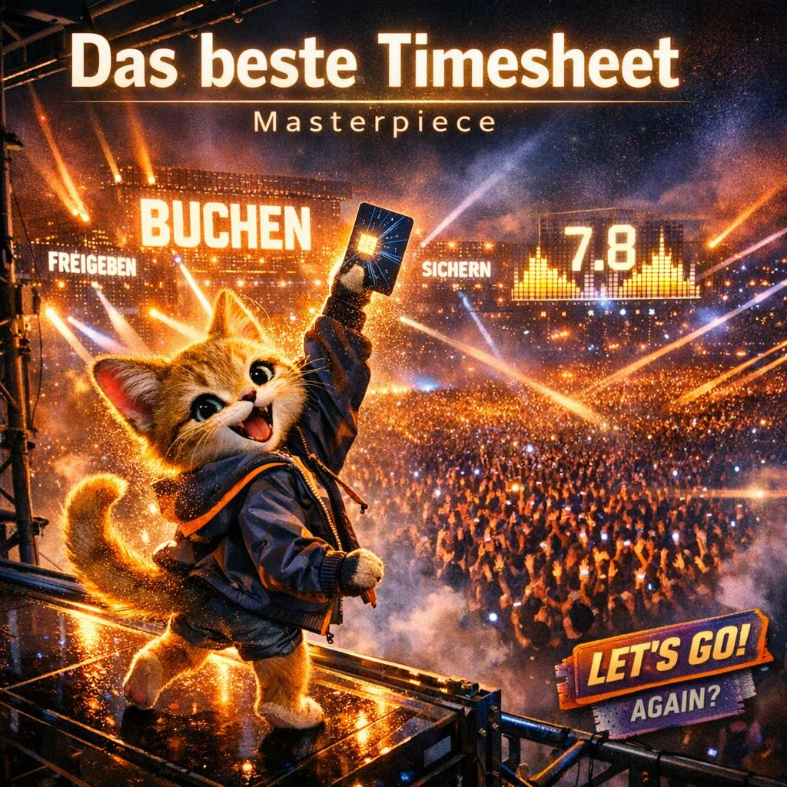

# *Future Bass* (Musikrichtung zu *Das beste Timesheet – 7,8*) 
 
#### Tracks & Workflow

[➜ Track 1 anhören](../audio/future_bass_1.mp3)
[➜ Track 2 anhören](../audio/future_bass_2.mp3)
[➜ Track 3 anhören](../audio/future_bass_3.mp3)
[➜ Track 4 anhören](../audio/future_bass_4.mp3)

[➜ ComfyUI_Workflow](../workflows/future_bass.json)

#### Genre-Cover & Bild-Prompt



```text
SCENE: An extreme wide, high-angle shot from the scaffolding above a massive open-air EDM festival mainstage at night, camera positioned high and far back. Square 1:1 future bass album cover, photorealistic cinematic still, epic festival-drop aesthetic, shot on 35mm, massive euphoric supersaw light beams, crisp horizontal lens flares, fine grain. A sea of thousands of raised hands and glowing wristbands far below, giant stadium laser arrays slicing through dense atmospheric festival smoke.
A photorealistic small anthropomorphic kitten girl — petite and youthful, rounded fluffy kitten head with anatomically believable structure, large oversized ears with soft inner fur tufts, very soft plush short golden-tabby fur catching the intense lights — stands on the very edge of the central DJ booth riser in the lower left corner of the frame, the glossy stage surface beneath her reflecting the intense laser drops in bright specular streaks. She wears a modern festival streetwear outfit with an oversized, unzipped technical shell jacket in dark indigo and luminous orange trim, physically accurate fabric drape. Her body is seen in a three-quarter rear view from behind. Her head is turned back over her shoulder toward the camera in a charming three-quarter view, both large bright eyes catching the flashing stage lights, mouth open in a triumphant, uplifting open-mouthed festival cheer, whiskers fanned, a joyful squint. She is posed in pure euphoric, pumping excitement — mid-leap on tiptoes, back arched, ears perked straight up, tail whipping upward in an energetic curl, a cloud of glowing neon stage dust flung off her fur by the motion. Her RIGHT arm is stretched fully vertical above her head, presenting a SMARTCARD heroically aloft in her paw like an ultimate mainstage pass — a sleek midnight-blue card with pulsing laser-etched geometric lines and a blindingly bright glowing gold chip, casting hard practical light on her paw, forearm, and face. Her LEFT arm lags behind, bent at the elbow at half height, paw open.
Palette: high-energy festival colors — explosive orange, deep indigo, electric violet, bright gold highlights, pumping EDM laser beams. Giant LED stadium screens behind the stage spell out a three-step sequence, staggered in depth across the stage architecture from near to far: "BUCHEN" largest and closest on the main DJ screen, "FREIGEBEN" mid-distance on the flanking video towers, "SICHERN" smallest and deepest on the horizon laser canvas. Bold, futuristic festival sans-serif caps.
Mid-ground center-right: a massive holographic stage volume display hovering above the crowd; its central digital EQ visualizer clearly displays the peak level numerals "7.8" in crisp, luminous white-gold neon vectors.
Typography composited cleanly over the image: large title "Das beste Timesheet" across the top, clean anthemic sans-serif, bright white with a soft gold outer glow. Below it, smaller subtitle "Masterpiece" in thin letterspaced caps. Bottom-right: a slightly tilted festival-wristband style badge "LET'S GO!" in bold italic caps, and just beneath it, smaller and semi-transparent, "AGAIN?".
Mood: epic, uplifting, mainstage stadium euphoria. Blown-out supersaw highlights, radiant bloom, polished commercial EDM color grade.
```

---

Zurück zur [➜ Übersicht der Musikrichtungen](styles.md) oder zurück zum [➜ Hauptdokument](../README.md).
