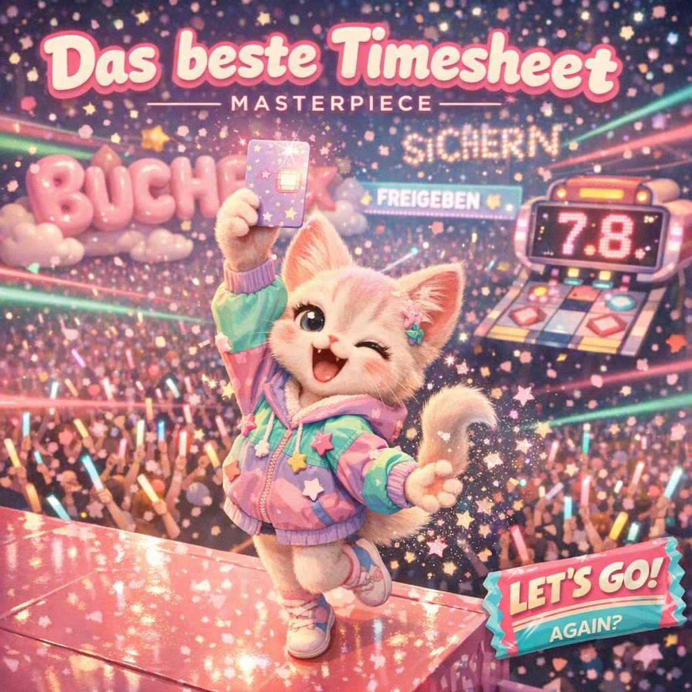

# *Kawaii Future Bass* (Musikrichtung zu *Das beste Timesheet – 7,8*) 
 
#### Tracks & Workflow

[➜ Track 1 anhören](../audio/kawaii_future_bass_1.mp3)
[➜ Track 2 anhören](../audio/kawaii_future_bass_2.mp3)
[➜ Track 3 anhören](../audio/kawaii_future_bass_3.mp3)
[➜ Track 4 anhören](../audio/kawaii_future_bass_4.mp3)

[➜ ComfyUI_Workflow](../workflows/kawaii_future_bass.json)

#### Genre-Cover & Bild-Prompt



```text
SCENE: An extreme wide, high-angle shot from the ceiling rafters of a vibrant, hyper-styled Kawaii pop concert stage filled with soft-sculpture clouds, camera positioned high and far back. Square 1:1 neon-pop future bass album cover, photorealistic cinematic still, hyper-cute future-bass aesthetic, shot on 35mm, candy-colored horizontal light rays, soft dreamy depth of field, pristine fine grain. A massive pastel-colored crowd shaking glowsticks far below, shimmering confetti drifting through cross-cutting pink and mint-green laser planes.
A photorealistic small anthropomorphic kitten girl — petite and youthful, rounded fluffy kitten head with anatomically believable structure, large oversized ears with soft inner fur tufts, incredibly soft plush short cream-colored fur with pastel pink highlights — stands on the very edge of a massive candy-pink stage riser in the lower left corner of the frame, the wet-look glossy stage surface beneath her reflecting the pastel laser drops in bright specular streaks. She wears an adorable, oversized decora-style streetwear windbreaker in block-patterns of soft mint green, lavender, and bubblegum pink, covered in cute plastic star clips, slightly too big for her small frame. Her body is seen in a three-quarter rear view from behind. Her head is turned back over her shoulder toward the camera in a charming three-quarter view, large sparkling round eyes catching the lights, mouth open in a sweet, affectionate, affectionate open-mouthed cheer, whiskers fanned, a joyful squint. She is posed in pure hyperactive, euphoric excitement — mid-leap on tiptoes with a bouncy rubber-like energy, back arched, ears perked straight up, tail whipping upward in an energetic curl, a cloud of glittering star-shaped confetti flung off her fur by the motion and caught in crisp detail. Her RIGHT arm is stretched fully vertical above her head, presenting a SMARTCARD heroically aloft in her paw like a concert pass — a matte lavender card covered in tiny star details and a blindingly bright sparkling pastel-pink glowing chip, casting hard cheerful light on her paw, forearm, and face. Her LEFT arm lags behind, bent at the elbow at half height, paw open in a loving gesture.
Palette: candy-pop pastel neon — bubblegum pink, soft mint turquoise, lavender, sweet banana yellow, warm rich synth glow. Floating inflatable stage decorations shaped like stars and clouds spell out a three-step sequence, staggered in depth from near to far: "BUCHEN" largest and closest as a giant pink inflatable letter group, "FREIGEBEN" mid-distance on a glowing digital banner, "SICHERN" smallest and deepest, twinkling as a soft light formation in the background. Round, bubbly display caps with soft outlines.
Mid-ground center-right: a giant, glossy retro arcade dance pad machine glowing on stage; its massive overhead digital combo-counter screen clearly displays the score numerals "7.8" in bold, sparkling candy-pink LED fonts.
Typography composited cleanly over the image: large title "Das beste Timesheet" across the top, bubbly rounded display font, ivory white with a soft pastel pink outer glow. Below it, smaller subtitle "Masterpiece" in thin letterspaced caps. Bottom-right: a slightly tilted candy-wrapper style badge "LET'S GO!" in bold italic caps, and just beneath it, smaller and semi-transparent, "AGAIN?".
Mood: zuckersüß, hyper-happy, energetic festival euphoria. Shimmering confetti bloom, soft rubbery bounce textures, saturated kawaii-pop color grade.
```

---

Zurück zur [➜ Übersicht der Musikrichtungen](styles.md) oder zurück zum [➜ Hauptdokument](../README.md).
