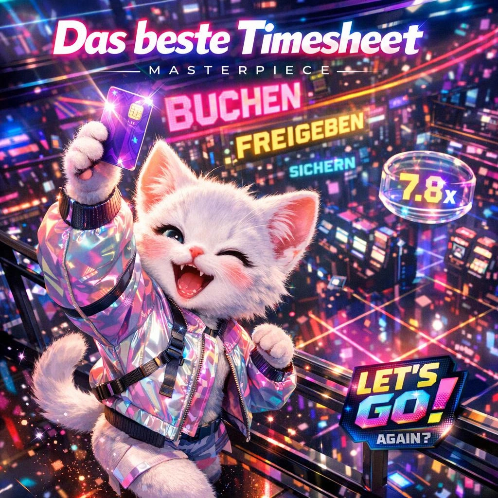

# *Lazrpop* (Musikrichtung zu *Das beste Timesheet – 7,8*) 
 
#### Tracks & Workflow

[➜ Track 1 anhören](../audio/lazrpop_1.mp3)
[➜ Track 2 anhören](../audio/lazrpop_2.mp3)
[➜ Track 3 anhören](../audio/lazrpop_3.mp3)
[➜ Track 4 anhören](../audio/lazrpop_4.mp3)

[➜ ComfyUI-Workflow](../workflows/lazrpop.json)

#### Genre-Cover & Bild-Prompt



```text
SCENE: An extreme wide, high-angle shot from the upper gallery inside a flashing, high-energy virtual reality arcade and gaming zone, camera positioned high and far back. Square 1:1 K-pop single cover, photorealistic cinematic still, ultra-bright gaming pop aesthetic, shot on 35mm, shallow depth of field, playful prismatic lens flares, vibrant high-gloss finish. Rows of futuristic arcade cabinets, neon laser tag grids, and floating holographic UI elements far below.
A photorealistic small anthropomorphic kitten girl — petite and youthful, rounded fluffy kitten head with anatomically believable structure, large oversized ears with soft inner fur tufts, very soft plush short white fur catching multi-colored light — stands on top of a glossy arcade platform panel in the lower left corner of the frame, the high-gloss plastic surface beneath her reflecting the colorful strobes in sharp specular streaks. She wears a sassy, youthful streetwear outfit featuring a pastel holographic oversized bomber jacket and tech-wear straps, slightly too big for her small frame, physically accurate fabric drape. Her body is seen in a three-quarter rear view from behind. Her head is turned back over her shoulder toward the camera in a charming three-quarter view, both large bright expressive eyes catching the playful light, mouth open in a cheerful, charismatic rapid-fire shouting cheer, whiskers fanned, a joyful squint. She is posed in pure euphoric, sassy excitement — mid-leap on tiptoes, back arched, ears perked straight up, tail whipping upward in an energetic curl, tiny floating digital pixel particles flung off her fur by the motion and caught in crisp detail. Her RIGHT arm is stretched fully vertical above her head, presenting a SMARTCARD heroically aloft in her paw like an ultimate gaming unlock — a glossy violet card with laser-etched geometric lines and a sparkling multi-colored prismatic glowing chip, casting hard practical neon light on her paw, forearm, and laughing face. Her LEFT arm lags behind, bent playfully at the elbow at half height.
Palette: ultra-bright gaming neon — playful laser pink, vibrant turquoise, electric violet, bright yellow accents, clean energetic highlights. Floating virtual gaming combo counters and retro-futuristic scoreboards spell out a three-step sequence, staggered in depth from near to far: "BUCHEN" largest and closest floating in neon pink, "FREIGEBEN" mid-distance in bright yellow, "SICHERN" smallest and deepest, pixelated in the background haze. Chunky gaming sans-serif caps.
Mid-ground center-right: a large floating, translucent virtual 3D gaming item capsule hovering in mid-air, glowing with vibrant pop lines, the numerals "7.8" clearly legible inside as a bright glowing floating multiplier stat.
Typography composited cleanly over the image: large title "Das beste Timesheet" across the top, playful bold K-pop style sans-serif, white with a multi-colored gradient outer glow. Below it, smaller subtitle "Masterpiece" in thin letterspaced caps. Bottom-right: a tilted arcade-style "LET'S GO!" pixel badge in bold caps, and just beneath it, smaller and semi-transparent, "AGAIN?".
Mood: giddy, playful, hyper-energetic gaming celebration. Colorful strobe bloom, playful reflections, high-energy pop grade.
```

---

Zurück zur [➜ Übersicht der Musikrichtungen](styles.md) oder zurück zum [➜ Hauptdokument](../README.md).
