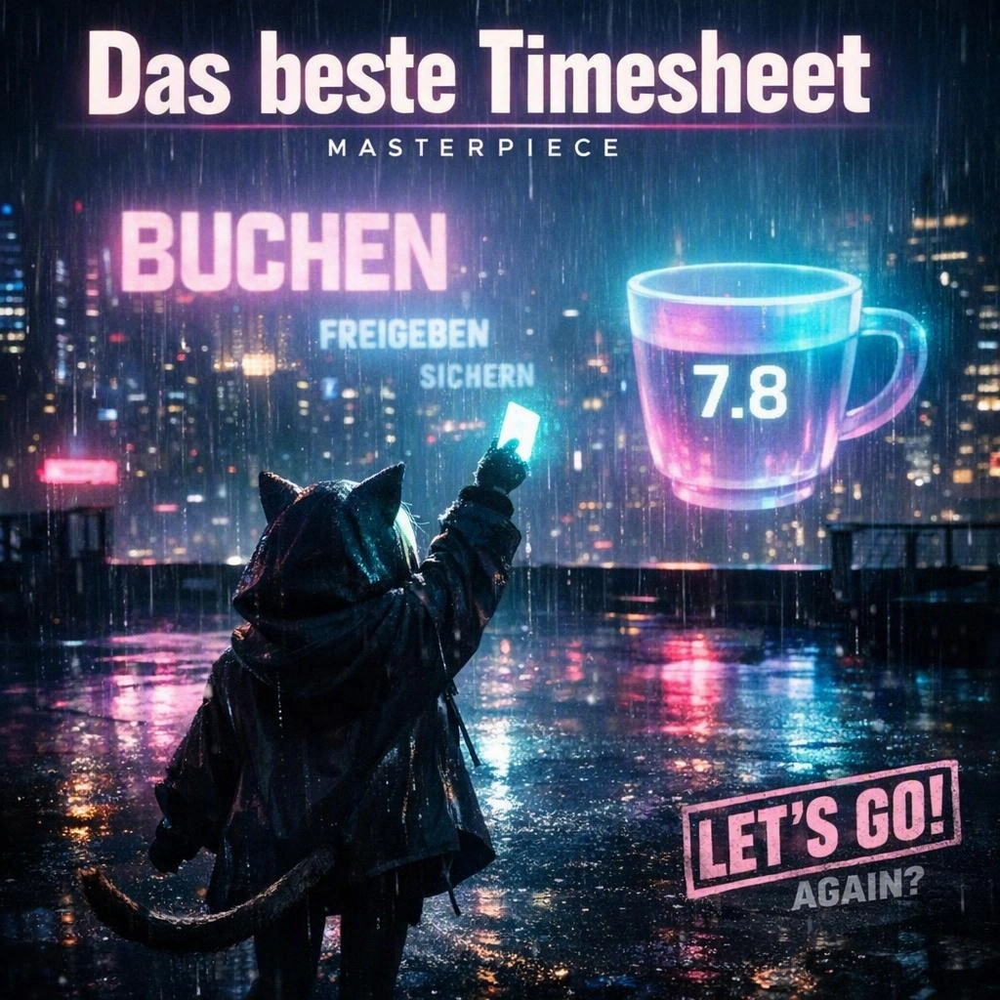

# *Neon-Synth-Wave* (Musikrichtung zu *Das beste Timesheet – 7,8*) 
 
#### Tracks & Workflow

[➜ Track 1 anhören](../audio/neon_synth_wave_1.mp3)
[➜ Track 2 anhören](../audio/neon_synth_wave_2.mp3)
[➜ Track 3 anhören](../audio/neon_synth_wave_3.mp3)
[➜ Track 4 anhören](../audio/neon_synth_wave_4.mp3)

[➜ ComfyUI_Workflow](../workflows/neon_synth_wave.json)

#### Genre-Cover & Bild-Prompt



```text
Square 1:1 K-pop single album cover, photorealistic cinematic still, Cyberpunk 2077 aesthetic, shot on 35mm, shallow-ish depth of field, anamorphic lens flares, fine film grain. Rain-soaked rooftop of a high-rise at night, sprawling neon megacity behind. Wide shot, over-the-shoulder framing from just behind and above the subject. Wet asphalt and gravel surface with standing water, specular neon reflections, visible falling rain caught in the light.
Palette: CP77 neon — magenta, cyan, acid yellow, deep blue-black shadows, no warm practicals.
Holographic skyline signage spells out a three-step sequence, staggered in depth from near to far: "BUCHEN" largest and closest, "FREIGEBEN" mid-distance, "SICHERN" smallest and deepest in the rain haze. Condensed caps, glowing softly out of focus with faint scan-flicker, each partially occluded by rain and towers.
Foreground, lower-left, close to camera and slightly out of focus at the edges: a small catgirl figure — petite, oversized coat, hood up with two dedicated openings through which her pointed cat ears protrude, backlit and clearly silhouetted against the neon. A long slender cat tail curves out from under the coat hem, wet fur catching neon rim-light. Seen over the shoulder from behind, shoulders lifted, one arm stretched upward in an excited gesture. In that raised hand, a GLOWING SMARTCARD, cyan-white, practically lighting her hood interior, hand and the rain around it. Head tilted up toward the hologram.
Mid-ground center-right: a large translucent holographic coffee cup projected in mid-air, cyan-magenta volumetric light, the numerals "7.8" clearly legible inside in white, faint holographic scan-flicker.
Typography composited cleanly over the image: large title "Das beste Timesheet" across the top, bold sans-serif, white with subtle magenta glow. Below it, smaller subtitle "Masterpiece" in thin letterspaced caps. Bottom-right: a slightly tilted stamp-style badge "LET'S GO!" in bold caps, and just beneath it, smaller and semi-transparent, "AGAIN?".
Mood: euphoric, giddy, rain-soaked celebration. Cinematic neon, wet highlights, lens bloom, shallow warm-free color grade.
```

```text
SCENE: An extreme wide, high-angle night shot from the rain-soaked rooftop of a high-rise building overlooking a sprawling neon megacity, camera positioned high and far back. Square 1:1 K-pop single album cover, photorealistic cinematic still, Cyberpunk 2077 aesthetic, shot on 35mm, crisp anamorphic lens flares, fine film grain. Wet asphalt and gravel surface with standing water reflecting the neon lights in mirror-clear specular streaks, visible falling rain caught in the sharp light.
A photorealistic small anthropomorphic kitten girl — petite and youthful, rounded fluffy kitten head with anatomically believable structure, large oversized ears with soft inner fur tufts and backlit translucency, very soft plush short dark brindled fur with visible individual hairs, whiskers catching the neon light, small paws, slender fluffy tail curled upward at the tip — stands at the rooftop's edge in the lower left corner of the frame. She wears an oversized high-tech neon-accented windbreaker jacket, slightly too big for her small frame, physically accurate fabric drape, hem lifted by the draught. Her body is seen in a three-quarter rear view, mostly from behind and partly from the side, her back and one shoulder turned toward the camera. Her head is turned back over her shoulder toward the camera in a charming three-quarter view, both large bright eyes catching the neon glare, muzzle and cheek fully visible, mouth open in a delighted open-mouthed cheer, whiskers fanned, a joyful squint. She is posed in pure euphoric excitement — mid-leap on tiptoes, back arched, ears perked straight up, tail whipping upward in an energetic curl, tiny droplets of rainwater flung off her fur by the motion and caught in crisp motion-frozen detail. Her RIGHT arm is stretched fully vertical above her head, presenting a SMARTCARD heroically aloft in her paw like a trophy — a sleek translucent neon card with glowing cyan-white circuit traces, casting hard practical light on her paw, forearm, jawline and the rain around it. Her LEFT arm lags behind, bent at the elbow at roughly half height, paw open and empty, clearly on its way up to join the cheer — an asymmetric, playful gesture.
Palette: Cyberpunk neon — magenta, cyan, acid yellow, deep blue-black shadows, no warm practicals. Holographic skyline signage spells out a three-step sequence, staggered in depth from near to far: "BUCHEN" largest and closest, "FREIGEBEN" mid-distance, "SICHERN" smallest and deepest in the rain haze. Condensed caps, glowing softly with faint scan-flicker, each partially occluded by rain and towers.
Mid-ground center-right: a sleek, metallic rooftop ventilation terminal or server node; an integrated digital status screen clearly displays the system data numerals "7.8" in crisp, luminous cyan-white LED segments.
Typography composited cleanly over the image: large title "Das beste Timesheet" across the top, bold sans-serif, white with subtle magenta glow. Below it, smaller subtitle "Masterpiece" in thin letterspaced caps. Bottom-right: a slightly tilted stamp-style badge "LET'S GO!" in bold caps, and just beneath it, smaller and semi-transparent, "AGAIN?".
Mood: euphoric, giddy, rain-soaked celebration. Cinematic neon, wet highlights, lens bloom, shallow warm-free color grade.
```

```text
SCENE: An extreme wide, high-angle shot from the top of a sleek cyberpunk skyscraper ledge overlooking a sprawling futuristic electronic metropolis at night, camera positioned high and far back. Square 1:1 high-production cyber-pop album cover, photorealistic cinematic still, high-tech neon-wave aesthetic, shot on 35mm, crisp anamorphic horizontal blue lens flares, sharp contrast, fine film grain. A pulsing sea of endless neon light grids, holographic traffic lanes, and towering skyscrapers far below.
A photorealistic small anthropomorphic kitten girl — petite and youthful, rounded fluffy kitten head with anatomically believable structure, large oversized ears with soft inner fur tufts catching the blue light, very soft plush short silver-grey fur — stands at the absolute edge of the glowing skyscraper ledge in the lower left corner of the frame, the polished carbon-fiber surface beneath her reflecting the intense city lights in mirror-sharp specular streaks. She wears a high-tech, form-fitting cyber jacket with glowing embedded fiber-optic neon strips and dark chrome trim, physically accurate fabric drape. Her body is seen in a three-quarter rear view from behind. Her head is turned back over her shoulder toward the camera in a charming three-quarter view, both large bright neon-blue eyes catching the light, mouth open in a vibrant, high-energy open-mouthed cheer, whiskers fanned, a joyful squint. She is posed in pure euphoric excitement — mid-leap on tiptoes, back arched, ears perked straight up, tail whipping upward in an energetic curl, subtle static electricity sparks caught in her fur by the motion. Her RIGHT arm is stretched fully vertical above her head, presenting a SMARTCARD heroically aloft in her paw like a high-tech beacon — a sleek translucent cyan card with pulsing electronic geometric grid patterns and a blindingly bright neon-blue glowing chip, casting hard practical light on her paw, forearm, jawline, and the surrounding night air. Her LEFT arm lags behind, bent at the elbow at half height, paw open.
Palette: vibrant neon magenta, electric cyan, high-voltage laser green, deep high-contrast midnight indigo shadows. Towering holographic skyline advertisements spell out a three-step sequence, staggered in depth from near to far: "BUCHEN" largest and closest as a pulsing magenta hologram, "FREIGEBEN" mid-distance in electric cyan with faint scanlines, "SICHERN" smallest and deepest, glowing softly with faint scan-flicker. Condensed geometric caps.
Mid-ground center-right: a sleek, parked futuristic hover-bike; its floating digital heads-up display (HUD) projected in mid-air clearly displays the numerals "7.8" in crisp, luminous neon-white vector lines.
Typography composited cleanly over the image: large title "Das beste Timesheet" across the top, bold cyber-geometric sans-serif, bright white with a sharp cyan neon outer glow. Below it, smaller subtitle "Masterpiece" in thin letterspaced caps. Bottom-right: a slightly tilted cybernetic digital badge "LET'S GO!" in bold caps, and just beneath it, smaller and semi-transparent, "AGAIN?".
Mood: electric, high-tech, adrenaline-fueled night euphoria. Intense neon bloom, sharp digital contrast, polished cyber grade.
```

---

Zurück zur [➜ Übersicht der Musikrichtungen](styles.md) oder zurück zum [➜ Hauptdokument](../README.md).
