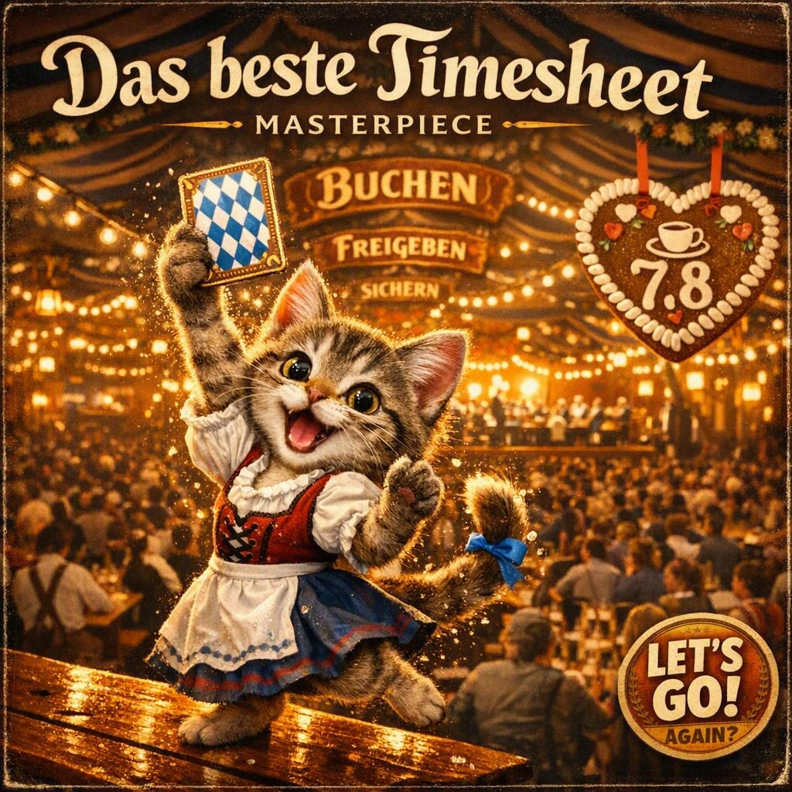

# *Oktoberfest* (Musikrichtung zu *Das beste Timesheet – 7,8*) 
 
#### Tracks & Workflow

[➜ Track 1 anhören](../audio/oktoberfest_1.mp3)
[➜ Track 2 anhören](../audio/oktoberfest_2.mp3)
[➜ Track 3 anhören](../audio/oktoberfest_3.mp3)
[➜ Track 4 anhören](../audio/oktoberfest_4.mp3)

[➜ ComfyUI-Workflow](../workflows/oktoberfest.json)

#### Genre-Cover & Bild-Prompt



```text
SCENE: An extreme wide, high-angle night shot across the interior of a packed Bavarian beer tent, camera positioned high and far back near the tent gable. Square 1:1 Volksmusik LP sleeve, photorealistic cinematic still, Wiesn aesthetic, shot on 50mm, shallow-ish depth of field, warm tungsten halation, fine film grain. Endless rows of wooden trestle tables below, blue-and-white chequered banners, a brass band platform glowing in the background, string lights overhead.
A photorealistic small anthropomorphic kitten girl — petite and youthful, rounded fluffy kitten head with anatomically believable structure, large oversized ears with soft inner fur tufts and backlit translucency, very soft plush short brindled fur with visible individual hairs, whiskers catching the string lights, small paws, slender fluffy tail curled upward at the tip with a small blue ribbon near the tip — stands ON a bench at the edge of the frame, lower left corner, above the crowd, the beer-slicked planks beneath her reflecting the amber glow in realistic specular streaks. She wears an oversized Dirndl-inspired bodice with a crisp white blouse and apron, slightly too big for her small frame, physically accurate fabric drape. Her body is seen in a three-quarter rear view, mostly from behind and partly from the side, her back and one shoulder turned toward the camera. Her head is turned back over her shoulder toward the camera in a charming three-quarter view, both large bright eyes catching the light, muzzle and cheek fully visible, mouth open in a delighted open-mouthed cheer, whiskers fanned, a joyful squint. She is posed in pure euphoric excitement — mid-leap on tiptoes, back arched, ears perked straight up, tail whipping upward in an energetic curl, tiny droplets of beer and foam flung off her fur by the motion and caught in crisp motion-frozen detail. Her RIGHT arm is stretched fully vertical above her head, presenting a SMARTCARD heroically aloft in her paw like a trophy — a blue-and-white chequered card with carved-wood edging and gold folk-art scrollwork, backlit warm gold by the string lights, throwing warm bounced light onto her paw, forearm and jawline. Her LEFT arm lags behind, bent at the elbow at roughly half height, paw open and empty, clearly on its way up to join the cheer — an asymmetric, playful gesture.
Palette: warm amber, beer gold, Bavarian blue and white, deep brown timber shadows, no neon. Painted tent gable signage and hanging carnival boards spell out a three-step sequence, staggered in depth from near to far: "BUCHEN" largest and closest on a carved wooden shield, "FREIGEBEN" mid-distance on a painted banner over the band stage, "SICHERN" smallest and deepest in the haze at the far end of the tent. Bold folk-display lettering with gold outline and folk-art flourishes, each partially occluded by garlands and lanterns.
Mid-ground center-right: a giant gingerbread Lebkuchenherz hanging on a ribbon, turned to camera, shaped with a coffee-cup icing motif, the numerals "7.8" piped clearly inside in white royal icing, sugar pearls around the edge.
Typography composited cleanly over the image: large title "Das beste Timesheet" across the top, heavy folk-display serif with white outline, cream with warm gold glow. Below it, smaller subtitle "Masterpiece" in thin letterspaced caps. Bottom-right: a slightly tilted beer-mat-style round badge "LET'S GO!" in bold caps, and just beneath it, smaller and semi-transparent, "AGAIN?".
Mood: euphoric, rowdy, communal toast at peak evening. Warm tungsten glow, golden bloom, cosy heavy grade.
```

---

Zurück zur [➜ Übersicht der Musikrichtungen](styles.md) oder zurück zum [➜ Hauptdokument](../README.md).
