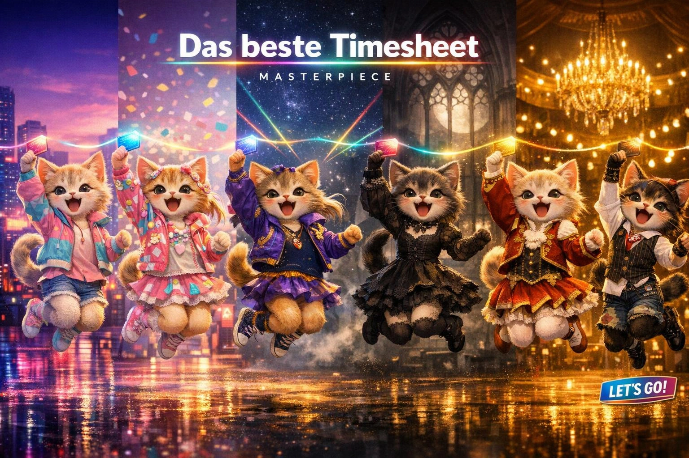
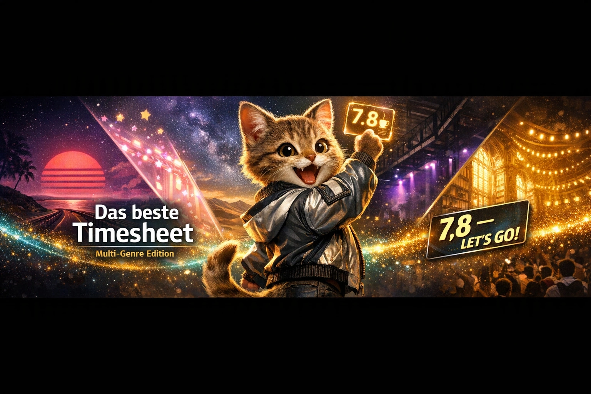

## Preview Image

#### Variante 01:  Das 6-teiliges Style-Panorama (6 Kätzchen nebeneinander)



````text
SUBJECT: Six photorealistic small anthropomorphic kitten girls, petite and youthful, rounded fluffy kitten heads, large ears with soft inner tufts, plush fur, standing side by side in one wide panorama. All six leap mid-air on tiptoes at the same moment, ears perked, tails curled upward, each with a delighted open-mouthed cheer and joyful squint, each raising a glowing SMARTCARD high with the right arm. Every kitten is clearly, unmistakably happy; in the dark zones her cheerful joy deliberately contrasts with the setting.
ZONES, left to right, blending seamlessly into each other:
1. Synthwave/Cyberpunk: pastel windbreaker, neon sunset city, rain reflections.
2. Kawaii/Gaming: decora jacket, pastel confetti, arcade lights.
3. Festival/Desert: indigo shell jacket and gold-embroidered bomber, lasers over starlit dunes.
4. Gothic/Darkwave: velvet dress and lace, cathedral window, moonlight and fog.
5. Orchestral: crimson-and-gold robe, golden concert hall, chandelier.
6. Jazz/Punk/Volksmusik: pinstripe waistcoat and patched denim, brass, string lights of a beer tent.
LIGHT & FX: Each zone has its own lighting. A shared ribbon of cyan-gold light connects all six smartcards across the image.
COLOR PALETTE: Sunset Magenta #FF2E88, Electric Cyan #2EE6FF, Lavender #C8B6FF, Plum #4A1A4F, Antique Gold #D4A23A, Bavarian Blue #2F6FD6.
TYPOGRAPHY: Title "Das beste Timesheet" centered, slightly above the kittens' heads, bold clean sans-serif, white with soft multicolor glow. Subtitle "Masterpiece" directly below in thin letterspaced caps. Small badge "LET'S GO!" lower right, level with the kittens' paws. Keep all text and figures within the central horizontal band of the image, with plain empty sky at the top edge and empty floor at the bottom edge.
STYLE: Photorealistic cinematic group cover, 35mm look, fine grain, clean balanced composition, 3:2 landscape format.
Spell all text exactly as written, no additional text.
````

#### Variante 02: Das Prisma-Zentrum (1 großes Hauptporträt + 6 Flügel-Sektoren)



````text
SCENE: A wide 3:2 panoramic key art banner (1536x1024) designed with generous top and bottom margins so the central horizontal band can later be cropped cleanly to a 2:1 GitHub social preview (1280x640). Photorealistic cinematic still, shot on 35mm, crisp focus, rich lighting, fine film grain.

CENTER HERO: In the central safe zone, a photorealistic small anthropomorphic kitten girl — petite and youthful, rounded fluffy kitten head with anatomically believable structure, large oversized ears with soft inner fur tufts, very soft plush short warm brindled fur with visible individual hairs, whiskers catching the light, slender fluffy tail curled upward — is seen in a joyful three-quarter rear view from mid-thigh up, turning her head back over her shoulder toward the camera with bright sparkling eyes and a delighted open-mouthed cheer. She wears an oversized sleek silver-and-charcoal techwear bomber jacket. Her RIGHT arm is raised high (keeping her paw well inside the central vertical safe zone, at least 18% below the top edge), holding up a glowing holographic SMARTCARD displaying the crisp numerals "7.8" and a stylized coffee-cup icon in warm white-gold light, illuminating her fur and face.

6 RADIATING GENRE SECTORS: Behind and around her central figure, the wide background splits into six seamless, dynamic prism-like diagonal sectors radiating outward from left to right, representing her musical workday journey:
1. Far Left (Retro-Synth-Wave): 1980s twilight coastal highway, glowing magenta sun and electric cyan neon grid.
2. Mid-Left (Kawaii Future Bass): Pastel bubble-pink and mint concert stage with floating star confetti and candy light rays.
3. Inner-Left (Desert Dream Pop): Starlit desert sand dunes under a glowing silver-violet Milky Way.
4. Inner-Right (Witch House & Acid Rave): Moody industrial steel rafters with amethyst-purple fog and UV neon-green laser beams.
5. Mid-Right (Symphonic Epic Pop): Grand golden archive cathedral with towering bookshelves and radiant sunbeams.
6. Far Right (Deutschpop-Rock & Oktoberfest): Warm amber stadium floodlights and festive golden beer-tent string lights.

ENVIRONMENT & FX: A continuous swirling ribbon of glowing golden and cyan stardust weaves horizontally across all six sectors behind her, unifying the composition. Clean, uncluttered framing without random floating letters in the background.

TYPOGRAPHY: Placed cleanly inside the central safe zone to the left and right of her torso (well away from top and bottom edges) with subtle dark frosted-glass backing for crisp legibility: On the left side, large bold title "Das beste Timesheet" in modern white sans-serif with a warm gold-cyan glow, and smaller subtitle "Multi-Genre Edition" underneath. On the right side, a tilted glossy badge "7,8 — LET'S GO!" in bold italic caps.

MOOD: Euphoric, triumphant, playful celebration across many musical worlds, high-contrast photorealistic grade.
Spell all text exactly as written, no additional text.
````

---

Hier geht es zurück zum [➜ Hauptdokument](../README.md).
