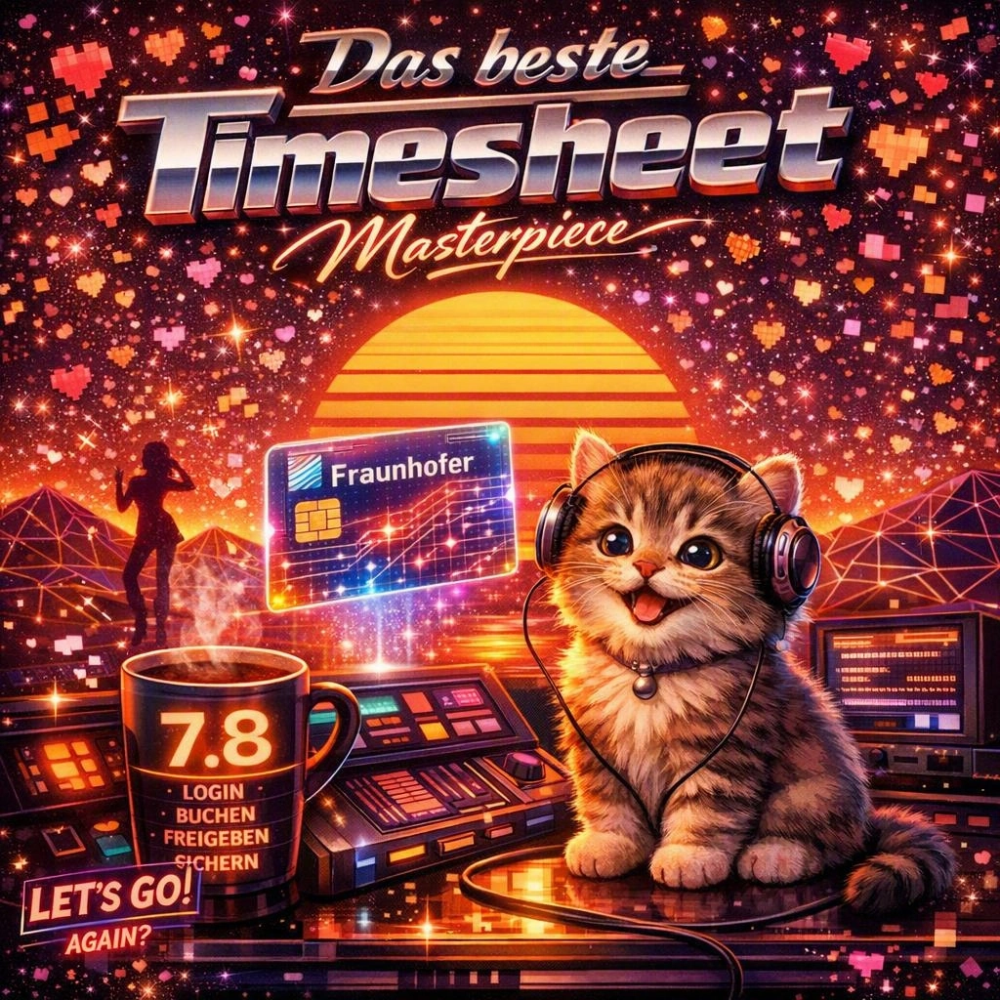

# *Retro-Synth-Wave* (Musikrichtung zu *Das beste Timesheet – 7,8*) 

#### Tracks & Workflow

[➜ Track 1 anhören](../audio/retro_synth_wave_1.mp3)
[➜ Track 2 anhören](../audio/retro_synth_wave_2.mp3)
[➜ Track 3 anhören](../audio/retro_synth_wave_3.mp3)
[➜ Track 4 anhören](../audio/retro_synth_wave_4.mp3)

[➜ ComfyUI-Workflow](../workflows/retro_synth_wave.json)

#### Genre-Cover & Bild-Prompt



```text
Square 1:1 retro-futuristic synth-pop single album cover, photorealistic cinematic still with subtle 1980s analog film aesthetic, shot on 35mm, shallow depth of field, warm anamorphic horizontal lens flares, fine vintage film grain. Scenic coastal highway overlook at twilight, overlooking a glowing retro-futuristic neon city and an endless ocean horizon with a giant stylized low-hanging sunset sun. Wide shot, over-the-shoulder framing from just behind and slightly below the subject. Sleek chrome-accented 1980s sports car parked beside the viewpoint, glossy wet-look pavement reflecting glowing magenta and turquoise lights, subtle atmospheric mist.
Palette: classic 80s Outrun and Neon-Wave — vibrant sunset magenta, electric cyan, warm amber-gold horizon glow, deep midnight indigo shadows.
Retro neon highway billboards and glowing skyline signage spell out a three-step sequence, staggered in depth along the coastal road from near to far: "BUCHEN" largest and closest in bright magenta neon, "FREIGEBEN" mid-distance in electric cyan, "SICHERN" smallest and deepest toward the glowing horizon. Clean retro-geometric caps, glowing softly with subtle neon tube hum and light bloom.
Foreground, lower-left, close to camera and softly framed at the edges: a photorealistic small anthropomorphic kitten girl — petite and youthful, rounded fluffy kitten head with anatomically believable structure, large oversized ears with soft inner fur tufts, very soft plush short pale fur. She is wearing an oversized 1980s retro windbreaker jacket in pastel cyan and magenta, pointed cat ears clearly silhouetted against the glowing sunset horizon, a slender cat tail curving out gracefully beneath the jacket hem catching warm golden-pink rim-light. Seen over the shoulder from behind in an euphoric, triumphant pose, head tilted slightly up toward the sky, one arm raised high toward the twilight. In her raised hand, a GLOWING SMARTCARD emitting bright cyan-white light, illuminating her fingers, jacket collar, and subtle lens flare.
Mid-ground center-right: inside the car's open window, the glowing digital dashboard dashboard instrumentation clearly displays the numerals "7.8" in sharp, retro-styled orange LED characters.
Typography composited cleanly over the image: large title "Das beste Timesheet" across the top in sleek 1980s chrome-and-white retro sans-serif with subtle magenta-cyan neon outer glow. Below it, smaller subtitle "Masterpiece" in thin, wide letterspaced caps. Bottom-right: a slightly tilted retro stamp-style badge "LET'S GO!" in bold italic caps, and just beneath it, smaller and semi-transparent, "AGAIN?".
Mood: euphoric, nostalgic, soaring sunset celebration. Dreamlike 80s synth-pop energy, radiant neon bloom, emotional twilight atmosphere.
```
---

Zurück zur [➜ Übersicht der Musikrichtungen](styles.md) oder zurück zum [➜ Hauptdokument](../README.md).
