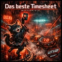
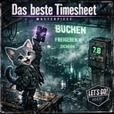
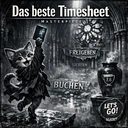
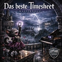
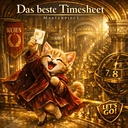

## Die Musikrichtungen

Alle Varianten dieses Songs wurden lokal mit **ACE-Step 1.5 in ComfyUI** gerendert. Um die Workflows schlank und performant zu halten, existiert **pro Musikrichtung ein eigener ComfyUI-Workflow** mit den dazugehörigen Subgraphs.

**Tipp für ComfyUI-Nutzer:** Alle veröffentlichten MP3-Dateien enthalten die vollständigen Workflow-Metadaten. Du kannst jede Audiodatei einfach per **Drag-and-Drop in ComfyUI** ziehen, um exakt diese Variante inklusive aller Parameter zu laden.

**Cover-Art & das *CATS*-Wortspiel:** Passend zum Zeiterfassungssystem **SAP CATS** zeigen die Cover-Arts (genau wie die monatlichen Erinnerungs-E-Mails) **Kätzchen**, generiert mit **GPT-Image**.

---

Die folgende Übersicht sortiert die Musikrichtungen nach dem dramaturgischen Verlauf eines perfekten Erfassungstages. Ein Klick auf die Musikrichtung führt direkt zur jeweiligen Unterseite mit den detaillierten Prompts und Beschreibungen.

|Cover|Musikrichtung, Emotion & Bezug zur Story|
|:---:|:---|
||**[➜ 01 · Dreamy Electropop](dreamy_electropop.md)** – *intim, warm, geborgen, sanft* [➜ Play Audio](../audio/dreamy_electropop_2.mp3) Sanfte, elektronische Klänge, die den Start des Arbeitstages begleiten.|
||**[➜ 02 · Retro-Synth-Wave](retro_synth_wave.md)** – *nostalgisch, treibend, neonfarben* [➜ Play Audio](../audio/retro_synth_wave_1.mp3) Nostalgischer, treibender Sound für den morgendlichen System-Login.|
||**[➜ 03 · Neon-Synth-Wave](neon_synth_wave.md)** – *cyberpunk, elektrisierend, tech-fokussiert* [➜ Play Audio](../audio/neon_synth_wave_1.mp3) Cyberpunk-Vibes für die hochmoderne, digitale Zeiterfassung.|
||**[➜ 04 · Lazrpop](lazrpop.md)** – *futuristisch, energetisch, synthetisch* [➜ Play Audio](../audio/lazrpop_1.mp3) Futuristischer, energetischer Pop-Sound für schnelles Tippen im Takt.|
||**[✖ 05 · Kawaii Future Bass](todo.md)** – *niedlich, elektronisch, zuckersüß* [✖ Play Audio](todo.md) Zuckersüße Klänge, ideal abgestimmt auf das flauschige CATS-Kätzchen.|
||**[✖ 06 · Future Bass](todo.md)** – *aufbauend, emotional, explosiv* [✖ Play Audio](todo.md) Kraftvoller, moderner EDM-Sound, der den Pre-Chorus pusht.|
||**[➜ 07 · Desert Dream Pop](desert_dream_pop.md)** – *schwebend, ätherisch, entspannend* [➜ Play Audio](../audio/desert_dream_pop_1.mp3) Schwebende Melodien für den perfekten Fokus während der Arbeit.|
||**[➜ 08 · Arabian Trap](arabian_trap.md)** – *mystisch, tief, rhythmisch* [➜ Play Audio](../audio/arabian_trap_2.mp3) Mystische, tiefe Bässe für komplexe Projektstrukturen.|
||**[➜ 09 · Cyber-Tribal](cyber_tribal.md)** – *hypnotisch, perkussiv, treibend* [➜ Play Audio](../audio/cyber_tribal_1.mp3) Rhythmische, treibende Beats, die den Buchungssprint anheizen.|
||**[✖ 10 · Witch House](todo.md)** – *düster, beklemmend, unheimlich* [✖ Play Audio](todo.md) Düstere, dichte Atmosphäre für die Tiefe des SAP-Systems.|
||**[✖ 11 · Darkwave-Goth](todo.md)** – *feierlich, melancholisch, düster* [✖ Play Audio](todo.md) Ein melancholisches, feierliches Ritual für die Zeiterfassung.|
||**[✖ 12 · Acid](todo.md)** – *psychedelisch, hypnotisch, blinkend* [✖ Play Audio](todo.md) Hypnotische 303-Synthesizer für den Rausch der Zahlenkolonnen.|
||**[✖ 13 · Symphonic Gothic Ballad](todo.md)** – *tragisch, emotional, gewaltig* [✖ Play Audio](todo.md) Epische, emotionale Erleichterung, wenn die Bridge einsetzt.|
||**[➜ 14 · Symphonic Epic Pop](symphonic_epic_pop.md)** – *majestätisch, heroisch, orchestral* [➜ Play Audio](../audio/symphonic_epic_pop_1.mp3) Erhebt das fehlerfreie Timesheet zu einem heroischen Finale.|
||**[➜ 15 · Cinematic Pop](cinematic_pop.md)** – *bombastisch, triumphierend, orchestral* [➜ Play Audio](../audio/cinematic_pop_1.mp3) Großer Kinoklang für die feierliche Freigabe durch das Management.|
||**[➜ 16 · Deutschpunk](deutschpunk.md)** – *roh, chaotisch, voller Antihaltung* [➜ Play Audio](../audio/deutschpunk_1.mp3) Pure, laute Rebellion im Takt gegen den monatlichen Abgabe-Stress.|
||**[➜ 17 · Deutschpop-Rock](deutschpop_rock.md)** – *hymnisch, emotional, treibend, melancholisch-optimistisch* [➜ Play Audio](../audio/deutschpop_rock_1.mp3) Rauher, ehrlicher Klavier-Rock für den großen emotionalen Rückblick auf den geschafften Arbeitstag.|
||**[✖ 18 · Dixieland](todo.md)** – *ausgelassen, blechern, handgemacht* [✖ Play Audio](todo.md) Ein humorvoller, beschwingter Marsch durch die Bürokratie.|
||**[✖ 19 · Oktoberfest](todo.md)** – *feucht-fröhlich, schunkelnd, kollektiv* [✖ Play Audio](todo.md) Der verdiente Feierabend! Die Freigabe steht, das System meldet Log out!|

---

Zurück zum [➜ Songtext](../lyrics/lyrics_format.md), zum [➜ Songtext mit Interpretation](../lyrics/lyrics_meaning.md) oder zurück zum [➜ Hauptdokument](../README.md).
