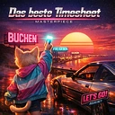
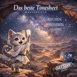

## Die Musikrichtungen

Alle Varianten dieses Songs wurden lokal mit **ACE-Step 1.5 in ComfyUI** gerendert. Um die Workflows schlank und performant zu halten, existiert **pro Musikrichtung ein eigener ComfyUI-Workflow** mit den dazugehörigen Subgraphs.

**Tipp für ComfyUI-Nutzer:** Alle veröffentlichten MP3-Dateien enthalten die vollständigen Workflow-Metadaten. Du kannst jede Audiodatei einfach per **Drag-and-Drop in ComfyUI** ziehen, um exakt diese Variante inklusive aller Parameter zu laden.

**Cover-Art & das *CATS*-Wortspiel:** Passend zum Zeiterfassungssystem **SAP CATS** zeigen die Cover-Arts (genau wie die monatlichen Erinnerungs-E-Mails) **Kätzchen**, generiert mit **GPT-Image**.

---

Die folgende Übersicht sortiert die Musikrichtungen nach dem dramaturgischen Verlauf eines perfekten Erfassungstages. Ein Klick auf die Musikrichtung führt direkt zur jeweiligen Unterseite mit den detaillierten Prompts und Beschreibungen.

|#|Cover|Musikrichtung & Emotion|Top-Track & Bezug zur Story|
|-:|:-:|:-|:-|
|01||[➜ Dreamy Electropop](dreamy_electropop.md) *intim, warm, geborgen, sanft*|[➜ Play Audio](../audio/dreamy_electropop_2.mp3) Sanfte, elektronische Klänge, die den Start des Arbeitstages begleiten.|
|02||[➜ Retro-Synth-Wave](retro_synth_wave.md) *nostalgisch, treibend, neonfarben*|[➜ Play Audio](../audio/retro_synth_wave_1.mp3) Nostalgischer, treibender Sound für den morgendlichen System-Login.|
|03||[➜ Neon-Synth-Wave](neon_synth_wave.md) *cyberpunk, elektrisierend, tech-fokussiert*|[➜ Play Audio](../audio/neon_synth_wave_1.md) Cyberpunk-Vibes für die hochmoderne, digitale Zeiterfassung.|
|04||[➜ Lazrpop](lazrpop.md) *futuristisch, energetisch, synthetisch*|[➜ Play Audio](../audio/lazrpop_1.mp3) Futuristischer, energetischer Pop-Sound für schnelles Tippen im Takt.|
|05||[✖ Kawaii Future Bass](todo.md) *niedlich, elektronisch, zuckersüß*|[✖ Play Audio](todo.md) Zuckersüße Klänge, ideal abgestimmt auf das flauschige CATS-Kätzchen.|
|06||[✖ Future Bass](todo.md) *aufbauend, emotional, explosiv*|[✖ Play Audio](todo.md) Kraftvoller, moderner EDM-Sound, der den Pre-Chorus pusht.|
|07||[➜ Desert Dream Pop](desert_dream_pop.md) *schwebend, ätherisch, entspannend*|[➜ Play Audio](../audio/desert_dream_pop_1.mp3) Schwebende Melodien für den perfekten Fokus während der Arbeit.|
|08||[➜ Arabian Trap](arabian_trap.md) *mystisch, tief, rhythmisch*|[➜ Play Audio](../audio/arabian_trap_2.mp3) Mystische, tiefe Bässe für komplexe Projektstrukturen.|
|09||[➜ Cyber-Tribal](cyber_tribal.md) *hypnotisch, perkussiv, treibend*|[➜ Play Audio](../audio/cyber_tribal_1.mp3) Rhythmische, treibende Beats, die den Buchungssprint anheizen.|
|10||[✖ Witch House](todo.md) *düster, beklemmend, unheimlich*|[✖ Play Audio](todo.md) Düstere, dichte Atmosphäre für die Tiefe des SAP-Systems.|
|11||[✖ Darkwave-Goth](todo.md) *feierlich, melancholisch, düster*|[✖ Play Audio](todo.md) Ein melancholisches, feierliches Ritual für die Zeiterfassung.|
|12||[✖ Acid](todo.md) *psychedelisch, hypnotisch, blinkend*|[✖ Play Audio](todo.md) Hypnotische 303-Synthesizer für den Rausch der Zahlenkolonnen.|
|13||[✖ Symphonic Gothic Ballad](todo.md) *tragisch, emotional, gewaltig*|[✖ Play Audio](todo.md) Epische, emotionale Erleichterung, wenn die Bridge einsetzt.|
|14||[➜ Symphonic Epic Pop](symphonic_epic_pop.md) *majestätisch, heroisch, orchestral*|[➜ Play Audio](../audio/symphonic_epic_pop_1.mp3) Erhebt das fehlerfreie Timesheet zu einem heroischen Finale.|
|15||[➜ Cinematic Pop](cinematic_pop.md) *bombastisch, triumphierend, orchestral*|[➜ Play Audio](../audio/cinematic_pop_1.mp3) Großer Kinoklang für die feierliche Freigabe durch das Management.|
|16||[➜ Deutschpunk](deutschpunk.md) *roh, chaotisch, voller Antihaltung*|[➜ Play Audio](../audio/deutschpunk_1.mp3) Pure, laute Rebellion im Takt gegen den monatlichen Abgabe-Stress.|
|17||[➜ Deutschpop-Rock](deutschpop_rock.md) *hymnisch, emotional, treibend, melancholisch-optimistisch*|[➜ Play Audio](../audio/deutschpop_rock_1.mp3) Rauher, ehrlicher Klavier-Rock für den großen emotionalen Rückblick auf den geschafften Arbeitstag.|
|18||[✖ Dixieland](todo.md) *ausgelassen, blechern, handgemacht*|[✖ Play Audio](todo.md) Ein humorvoller, beschwingter Marsch durch die Bürokratie.|
|19||[✖ Oktoberfest](todo.md) *feucht-fröhlich, schunkelnd, kollektiv*|[✖ Play Audio](todo.md) Der verdiente Feierabend! Die Freigabe steht, das System meldet Log out!|

---

Zurück zum [➜ Songtext](../lyrics/lyrics_format.md), zum [➜ Songtext mit Interpretation](../lyrics/lyrics_meaning.md) oder zurück zum [➜ Hauptdokument](../README.md).
