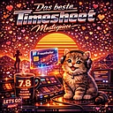
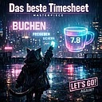
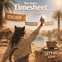
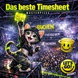
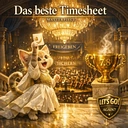
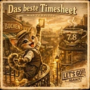
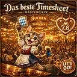
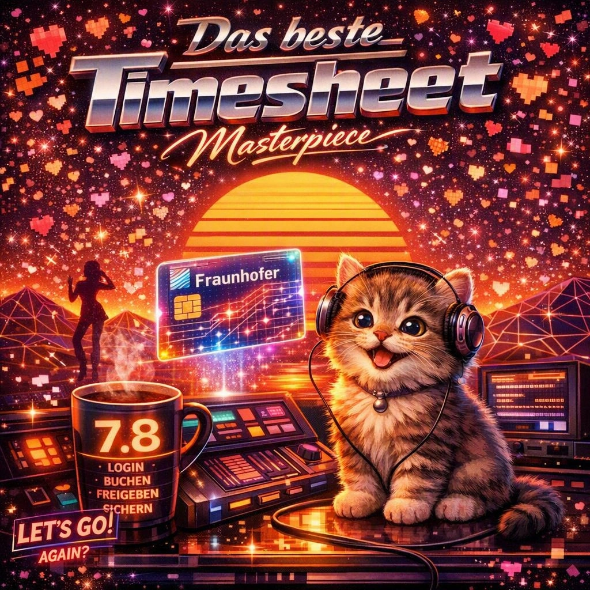

# Musikrichtungen, Workflows & Cover – *Das beste Timesheet – 7,8*

Alle Varianten dieses Songs wurden lokal mit **ACE-Step 1.5 in ComfyUI** gerendert. Um die Workflows schlank und performant zu halten, existiert **pro Musikrichtung ein eigener ComfyUI-Workflow** mit den dazugehörigen Subgraphs.

**Tipp für ComfyUI-Nutzer:** Alle veröffentlichten MP3-Dateien enthalten die vollständigen Workflow-Metadaten. Du kannst jede Audiodatei einfach per **Drag-and-Drop in ComfyUI** ziehen, um exakt diese Variante inklusive aller Parameter zu laden.

**Cover-Art & das *CATS*-Wortspiel:** Passend zum Zeiterfassungssystem **SAP CATS** zeigen die Cover-Arts (genau wie die monatlichen Erinnerungs-E-Mails) **Kätzchen oder Katzen**, generiert mit **Z-Image-Turbo** und **GPT-Image**.

---

## Übersicht der Musikrichtungen

| Nr. | Cover                                  | Musikrichtung                                  | Workflow                                          |
|:---:|:--------------------------------------:|:-----------------------------------------------|:-------------------------------------------------:|
| 01  |    | [➜ Retro-Synth-Wave](#01-retro-synth-wave)     | [➜ JSON](../workflows/01-retro-synth-wave.json)   |
| 02  |   | [➜ Dreamy Electropop](#02-dreamy-electropop)   | [➜ JSON](../workflows/02-dreamy-electropop.json)  |
| 03  |     | [➜ Neon-Synth-Wave](#03-neon-synth-wave)       | [➜ JSON](../workflows/03-neon-synth-wave.json)    |
| 04  |             | [➜ Lazrpop](#04-lazrpop)                       | [➜ JSON](../workflows/04-lazrpop.json)            |
| 05  |  | [➜ Kawaii Future Bass](#05-kawaii-future-bass) | [➜ JSON](../workflows/05-kawaii-future-bass.json) |
| 06  |         | [➜ Future Bass](#06-future-bass)               | [➜ JSON](../workflows/06-future-bass.json)        |
| 07  |        | [➜ Arabian Trap](#07-arabian-trap)             | [➜ JSON](../workflows/07-arabian-trap.json)       |
| 08  |    | [➜ Desert Dream Pop](#08-desert-dream-pop)     | [➜ JSON](../workflows/08-desert-dream-pop.json)   |
| 09  |        | [➜ Cyber-Tribal](#09-cyber-tribal)             | [➜ JSON](../workflows/09-cyber-tribal.json)       |
| 10  |         | [➜ Witch House](#10-witch-house)               | [➜ JSON](../workflows/10-witch-house.json)        |
| 11  |       | [➜ Darkwave-Goth](#11-darkwave-goth)           | [➜ JSON](../workflows/11-darkwave-goth.json)      |
| 12  |                | [➜ Acid](#12-acid)                             | [➜ JSON](../workflows/12-acid.json)               |
| 13  |    | [➜ Symphonic Gothic Ballad](#13-symphonic-gothic-ballad) | [➜ JSON](../workflows/13-symphonic-gothic.json) |
| 14  |  | [➜ Symphonic Epic Pop](#14-symphonic-epic-pop) | [➜ JSON](../workflows/14-symphonic-epic-pop.json) |
| 15  |       | [➜ Cinematic Pop](#15-cinematic-pop)           | [➜ JSON](../workflows/15-cinematic-pop.json)      |
| 16  |           | [➜ Dixieland](#16-dixieland)                   | [➜ JSON](../workflows/16-dixieland.json)          |
| 17  |         | [➜ Deutschpunk](#17-deutschpunk)               | [➜ JSON](../workflows/17-deutschpunk.json)        |
| 18  |         | [➜ Oktoberfest](#18-oktoberfest)               | [➜ JSON](../workflows/18-oktoberfest.json)        |

---

## Detailübersicht

### 01. Retro-Synth-Wave

A driving, retro-futuristic K-pop synth-wave track with a fast, cinematic retro bassline and sparkling neon-synth textures. The arrangement flows smoothly, bridging a dreamlike, melodic verse with lush vocal harmonies and a powerful, anthemic pop chorus built around an irresistible, nostalgia-fueled earworm hook. Elegant female vocals with a bright, euphoric and emotional delivery.

[➜ ComfyUI-Workflow](../workflows/01-retro-synth-wave.json)

#### Tracks
[➜ Track 01-1 anhören](../audio/01-1-retro-synth-wave.mp3)
[➜ Track 01-2 anhören](../audio/01-2-retro-synth-wave.mp3)
[➜ Track 01-3 anhören](../audio/01-3-retro-synth-wave.mp3)
[➜ Track 01-4 anhören](../audio/01-4-retro-synth-wave.mp3)

#### Genre-Cover & Bild-Prompt


```text
Square 1:1 retro-futuristic synth-pop single album cover, photorealistic cinematic still with subtle 1980s analog film aesthetic, shot on 35mm, shallow depth of field, warm anamorphic horizontal lens flares, fine vintage film grain. Scenic coastal highway overlook at twilight, overlooking a glowing retro-futuristic neon city and an endless ocean horizon with a giant stylized low-hanging sunset sun. Wide shot, over-the-shoulder framing from just behind and slightly below the subject. Sleek chrome-accented 1980s sports car parked beside the viewpoint, glossy wet-look pavement reflecting glowing magenta and turquoise lights, subtle atmospheric mist.
Palette: classic 80s Outrun and Neon-Wave — vibrant sunset magenta, electric cyan, warm amber-gold horizon glow, deep midnight indigo shadows.
Retro neon highway billboards and glowing skyline signage spell out a three-step sequence, staggered in depth along the coastal road from near to far: "BUCHEN" largest and closest in bright magenta neon, "FREIGEBEN" mid-distance in electric cyan, "SICHERN" smallest and deepest toward the glowing horizon. Clean retro-geometric caps, glowing softly with subtle neon tube hum and light bloom.
Foreground, lower-left, close to camera and softly framed at the edges: a petite anime-inspired catgirl figure wearing an oversized 1980s retro windbreaker jacket in pastel cyan and magenta, hood down, pointed cat ears clearly silhouetted against the glowing sunset horizon, a slender cat tail curving out gracefully beneath the jacket hem catching warm golden-pink rim-light. Seen over the shoulder from behind in an euphoric, triumphant pose, head tilted slightly up toward the sky, one arm raised high toward the twilight. In her raised hand, a GLOWING SMARTCARD emitting bright cyan-white light, illuminating her fingers, jacket collar, and subtle lens flare.
Mid-ground center-right: a large translucent holographic retro coffee mug projected in mid-air above the coast, glowing cyan-magenta volumetric neon lines, the numerals "7.8" clearly legible inside in crisp white light with subtle retro scanlines.
Typography composited cleanly over the image: large title "Das beste Timesheet" across the top in sleek 1980s chrome-and-white retro sans-serif with subtle magenta-cyan neon outer glow. Below it, smaller subtitle "Masterpiece" in thin, wide letterspaced caps. Bottom-right: a slightly tilted retro stamp-style badge "LET'S GO!" in bold italic caps, and just beneath it, smaller and semi-transparent, "AGAIN?".
Mood: euphoric, nostalgic, soaring sunset celebration. Dreamlike 80s synth-pop energy, radiant neon bloom, emotional twilight atmosphere.
```

---

### 02. Dreamy Electropop

Dreamy electropop, glowing analog synths, soft electronic heartbeat rhythm, lo-fi pop beat, intimate breathy female vocals, angelic clean voice, warm embrace ambiance, uplifting chorus, melodic, catchy, 110 bpm, E minor

[➜ ComfyUI-Workflow](../workflows/02-dreamy-electropop.json)

#### Tracks
[➜ Track 02-1 anhören](../audio/02-1-dreamy-electropop.mp3)
[➜ Track 02-2 anhören](../audio/02-2-dreamy-electropop.mp3)
[➜ Track 02-3 anhören](../audio/02-3-dreamy-electropop.mp3)
[➜ Track 02-4 anhören](../audio/02-4-dreamy-electropop.mp3)

#### Genre-Cover & Bild-Prompt


```text
TODO
```

---

### 03. Neon-Synth-Wave

A high-production cyber-pop and neon synth-wave masterpiece driven by a pulsing, futuristic 4/4 electronic dance-pop beat and bright, glowing neon plucks. The driving arrangement seamlessly blends energetic synthesizers with atmospheric vocoder effects in the background, creating a polished and high-tech electronic soundscape. The track builds into a catchy, irresistible electronic earworm hook, fronted by vibrant, high-energy vocals.

[➜ ComfyUI-Workflow](../workflows/03-neon-synth-wave.json)

#### Tracks
[➜ Track 03-1 anhören](../audio/03-1-neon-synth-wave.mp3)
[➜ Track 03-2 anhören](../audio/03-2-neon-synth-wave.mp3)
[➜ Track 03-3 anhören](../audio/03-3-neon-synth-wave.mp3)
[➜ Track 03-4 anhören](../audio/03-4-neon-synth-wave.mp3)

#### Genre-Cover & Bild-Prompt


```text
TODO
```

---

### 04. Lazrpop

A slick, ultra-bright K-pop track with an addictive, high-energy neon-pop aesthetic and electronic gaming sound effects. The production shifts seamlessly between sections—a playful yet confident, sassy verse with a bouncy tempo and charismatic rapid-fire rapping, a sultry R&B pre-chorus with alluring vocals and lush harmonies, then an explosive, synth-driven pop chorus with an irresistible earworm hook. Sleek, youthful female vocals with a cheerful, euphoric and seductive delivery.

[➜ ComfyUI-Workflow](../workflows/04-lazrpop.json)

#### Tracks
[➜ Track 04-1 anhören](../audio/04-1-lazrpop.mp3)
[➜ Track 04-2 anhören](../audio/04-2-lazrpop.mp3)
[➜ Track 04-3 anhören](../audio/04-3-lazrpop.mp3)
[➜ Track 04-4 anhören](../audio/04-4-lazrpop.mp3)

#### Genre-Cover & Bild-Prompt


```text
TODO
```

---

### 05. Kawaii Future Bass

Kawaii future bass, neon-pop: upbeat four-on-the-floor bounce; sweet, affectionate female vocals in a low, dark, nasal, reedy register, clipped rhythmic staccato with loving emotional delivery; wide detuned synth layers and shimmering drops; rubber-bounce synth bass, warm rich synths, sparkling chimes, cheerful brass stabs, uplifting symphonic flourishes

[➜ ComfyUI-Workflow](../workflows/05-kawaii-future-bass.json)

#### Tracks
[➜ Track 05-1 anhören](../audio/05-1-kawaii-future-bass.mp3)
[➜ Track 05-2 anhören](../audio/05-2-kawaii-future-bass.mp3)
[➜ Track 05-3 anhören](../audio/05-3-kawaii-future-bass.mp3)
[➜ Track 05-4 anhören](../audio/05-4-kawaii-future-bass.mp3)

#### Genre-Cover & Bild-Prompt


```text
TODO
```

---

### 06. Future Bass

melodic future bass, energetic edm, female and male duet vocals, pumping reese bass, euphoric supersaw synths, vocal chops, festival drop, uplifting, clean production

[➜ ComfyUI-Workflow](../workflows/06-future-bass.json)

#### Tracks
[➜ Track 06-1 anhören](../audio/06-1-future-bass.mp3)
[➜ Track 06-2 anhören](../audio/06-2-future-bass.mp3)
[➜ Track 06-3 anhören](../audio/06-3-future-bass.mp3)
[➜ Track 06-4 anhören](../audio/06-4-future-bass.mp3)

#### Genre-Cover & Bild-Prompt


```text
TODO
```

---

### 07. Arabian Trap

slick, high-energy modern arabic pop, trap fusion, upbeat tempo, fast hypnotic darbuka, tabla percussion, heavy driving sub-bass, trap drums, catchy synthesized middle-eastern string hook, maqam hijaz, charismatic, playful vocals, euphoric pop hook

[➜ ComfyUI-Workflow](../workflows/07-arabian-trap.json)

#### Tracks
[➜ Track 07-1 anhören](../audio/07-1-arabian-trap.mp3)
[➜ Track 07-2 anhören](../audio/07-2-arabian-trap.mp3)
[➜ Track 07-3 anhören](../audio/07-3-arabian-trap.mp3)
[➜ Track 07-4 anhören](../audio/07-4-arabian-trap.mp3)

#### Genre-Cover & Bild-Prompt


```text
TODO
```

---

### 08. Desert Dream Pop

lush, romantic, middle eastern ballad, dreamlike, starlit desert aesthetic, expressive oud plucking, floating qanun arpeggios, ambient sub-bass, smooth cinematic strings, ethereal vocal, folk-inspired harmonies, sustained emotional notes, seductive, mystical delivery

[➜ ComfyUI-Workflow](../workflows/08-desert-dream-pop.json)

#### Tracks
[➜ Track 08-1 anhören](../audio/08-1-desert-dream-pop.mp3)
[➜ Track 08-2 anhören](../audio/08-2-desert-dream-pop.mp3)
[➜ Track 08-3 anhören](../audio/08-3-desert-dream-pop.mp3)
[➜ Track 08-4 anhören](../audio/08-4-desert-dream-pop.mp3)

#### Genre-Cover & Bild-Prompt


```text
TODO
```
---

### 09. Cyber-Tribal

Haunting cyberpunk anime soundtrack, ambient synthesizers, sub-bass, traditional Japanese Taiko drums, haunting chimes, experimental percussion. Ethereal mystical female vocals, haunting non-lexical choral chanting, folk-inspired harmonies, melancholic and ritualistic atmosphere.

[➜ ComfyUI-Workflow](../workflows/09-cyber-tribal.json)

#### Tracks
[➜ Track 09-1 anhören](../audio/09-1-cyber-tribal.mp3)
[➜ Track 09-2 anhören](../audio/09-2-cyber-tribal.mp3)
[➜ Track 09-3 anhören](../audio/09-3-cyber-tribal.mp3)
[➜ Track 09-4 anhören](../audio/09-4-cyber-tribal.mp3)

#### Genre-Cover & Bild-Prompt


```text
TODO
```

---

### 10. Witch House

Witch house, cyber goth; hypnotic midtempo club stomp with dark ritual drum pulses; eerie ghostly female vocals in a warm mid-range, half-spoken talk-sing and rapid-fire verses, whispered ad-libs between lines; distorted reese bass and glassy glitch synths; industrial-shadowed textures, haunting tech atmosphere, shimmering hyper-pop chorus drops

[➜ ComfyUI-Workflow](../workflows/10-witch-house.json)

#### Tracks
[➜ Track 10-1 anhören](../audio/10-1-witch-house.mp3)
[➜ Track 10-2 anhören](../audio/10-2-witch-house.mp3)
[➜ Track 10-3 anhören](../audio/10-3-witch-house.mp3)
[➜ Track 10-4 anhören](../audio/10-4-witch-house.mp3)

#### Genre-Cover & Bild-Prompt


```text
TODO
```

---

### 11. Darkwave-Goth

Darkwave, 1980s goth rock, deep analog synthesizers, driving drum machine, melancholic female solo vocals, post-punk bassline

[➜ ComfyUI-Workflow](../workflows/11-darkwave-goth.json)

#### Tracks
[➜ Track 11-1 anhören](../audio/11-1-darkwave-goth.mp3)
[➜ Track 11-2 anhören](../audio/11-2-darkwave-goth.mp3)
[➜ Track 11-3 anhören](../audio/11-3-darkwave-goth.mp3)
[➜ Track 11-4 anhören](../audio/11-4-darkwave-goth.mp3)

#### Genre-Cover & Bild-Prompt


```text
SCENE: An extreme wide, high-angle night shot of a stone gallery high inside a derelict cathedral nave, camera positioned high and far back beneath the vaulting. Square 1:1 darkwave 12" sleeve, photorealistic cinematic still, 1980s post-punk gothic aesthetic, shot on 85mm, heavy grain, high-contrast near-monochrome with a single cold accent, print-like tonal crush. A shattered rose window, fog lying low across broken flagstones far below, a single shaft of moonlight from above.
A photorealistic small anthropomorphic kitten girl — petite and youthful, rounded fluffy kitten head with anatomically believable structure, large oversized ears with soft inner fur tufts and backlit translucency, very soft plush short dark brindled fur with visible individual hairs, whiskers catching the cold light, small paws, slender fluffy tail curled upward at the tip — stands at the gallery's edge in the lower left corner of the frame, the rain-wet stone beneath her reflecting the pale glow in realistic specular streaks. She wears an oversized high-collared black lace blouse under a long draped coat, slightly too big for her small frame, physically accurate fabric drape, hem lifted by the draught. Her body is seen in a three-quarter rear view, mostly from behind and partly from the side, her back and one shoulder turned toward the camera. Her head is turned back over her shoulder toward the camera in a charming three-quarter view, both large bright eyes catching the cold light, muzzle and cheek fully visible, mouth open in a delighted open-mouthed cheer, whiskers fanned, a joyful squint — warmth of expression against the austere setting. She is posed in pure euphoric excitement rendered as ritual — mid-leap on tiptoes, back arched, ears perked straight up, tail whipping upward in an energetic curl, tiny droplets of drizzle flung off her fur by the motion and caught in crisp motion-frozen detail. Her RIGHT arm is stretched fully vertical above her head, presenting a SMARTCARD heroically aloft in her paw like a relic — a matte-black card with silver etched sigils and a pale ice-blue glowing circuit trace, the only accent colour in frame, casting hard cold practical light on her paw, forearm, jawline and the mist around it. Her LEFT arm lags behind, bent at the elbow at roughly half height, paw open and empty, clearly on its way up to join the gesture — an asymmetric, playful counterpoint.
Palette: near-monochrome — charcoal, bone white, ash grey, with one cold accent of pale ice-blue; crushed blacks, no warmth whatsoever. Carved stone lettering and a torn paper poster spell out a three-step sequence, staggered in depth from near to far: "BUCHEN" largest and closest chiselled into a fallen slab, "FREIGEBEN" mid-distance on a tattered banner between columns, "SICHERN" smallest and deepest, barely legible in the fog at the apse. Condensed engraved caps, edges eroded, each partially occluded by mist and masonry.
Mid-ground center-right: a tall funerary urn on a plinth, glazed matte black, with a coffee-cup silhouette incised into it in bone white, the numerals "7.8" carved clearly inside, fog curling from the mouth of the urn.
Typography composited cleanly over the image: large title "Das beste Timesheet" across the top, stark condensed sans, bone white with a faint cold halo. Below it, smaller subtitle "Masterpiece" in thin letterspaced caps. Bottom-right: a slightly tilted wax-seal-style badge "LET'S GO!" in bold caps, and just beneath it, smaller and semi-transparent, "AGAIN?".
Mood: solemn, austere, elated in a funereal register. Cold moonlight, deep shadow, zero warm tones, heavy vignette.
```

---

### 12. Acid

Hypnotic techno, 303 acid bassline, industrial electronic percussion, minimal vocal processing, high energy club groove

[➜ ComfyUI-Workflow](../workflows/12-acid.json)

#### Tracks
[➜ Track 12-1 anhören](../audio/12-1-acid.mp3)
[➜ Track 12-2 anhören](../audio/12-2-acid.mp3)
[➜ Track 12-3 anhören](../audio/12-3-acid.mp3)
[➜ Track 12-4 anhören](../audio/12-4-acid.mp3)

#### Genre-Cover & Bild-Prompt


```text
SCENE: An extreme wide, high-angle 4am shot from atop a towering speaker stack in a derelict warehouse, camera positioned high and far back among the girders. Square 1:1 acid house 12" sleeve, photorealistic cinematic still, late-1980s rave aesthetic, shot on 24mm, wide and slightly distorted, hard strobe-lit foreground, heavy grain, chromatic fringing. Steel girders, strobe-lit smoke, walls of stacked speaker cabinets, a heaving crowd of silhouettes far below.
A photorealistic small anthropomorphic kitten girl — petite and youthful, rounded fluffy kitten head with anatomically believable structure, large oversized ears with soft inner fur tufts and backlit translucency, very soft plush short brindled fur with visible individual hairs glowing under UV, whiskers catching the strobe, small paws, slender fluffy tail curled upward at the tip with a UV-reactive stripe along its length — stands at the edge of the speaker stack in the lower left corner of the frame, the condensation-slick surface beneath her reflecting the acid glow in realistic specular streaks. She wears an oversized cropped mesh top over a bralette with baggy cargo trousers slung low and a bucket hat pushed back between her ears, slightly too big for her small frame, physically accurate fabric drape. Her body is seen in a three-quarter rear view, mostly from behind and partly from the side, her back and one shoulder turned toward the camera. Her head is turned back over her shoulder toward the camera in a charming three-quarter view, both large bright eyes catching the light, pupils wide, muzzle and cheek fully visible, mouth open in a delighted open-mouthed cheer, whiskers fanned, a joyful squint. She is posed in pure euphoric excitement — mid-leap on tiptoes, back arched, ears perked straight up, tail whipping upward in an energetic curl, tiny droplets of sweat and condensation flung off her fur by the motion and caught in crisp motion-frozen detail. Her RIGHT arm is stretched fully vertical above her head, presenting a SMARTCARD heroically aloft in her paw like a trophy — an acid-yellow card with a printed smiley chip and glowing lime-green circuit traces, blindingly lit from within, casting hard practical light on her paw, forearm, jawline and the smoke around it. Her LEFT arm lags behind, bent at the elbow at roughly half height, paw open and empty, clearly on its way up to join the cheer — an asymmetric, playful gesture.
Palette: acid yellow, hot lime green, magenta, UV violet, black; blown highlights, no warm practicals. Spray-painted wall lettering and a stretched banner spell out a three-step sequence, staggered in depth from near to far: "BUCHEN" largest and closest sprayed in dripping acid yellow on raw concrete, "FREIGEBEN" mid-distance stencilled across a speaker stack, "SICHERN" smallest and deepest, warping through the smoke at the back wall. Bulbous bubble-graffiti caps with hard outlines and drips, each partially occluded by smoke, girders and laser planes.
Mid-ground center-right: a huge inflatable coffee cup bobbing above the crowd, glossy acid-yellow vinyl with a printed smiley, the numerals "7.8" screen-printed clearly on the side in black, caught mid-strobe.
Typography composited cleanly over the image: large title "Das beste Timesheet" across the top, chunky rave-flyer sans with a hard black outline, acid yellow with green glow. Below it, smaller subtitle "Masterpiece" in thin letterspaced caps. Bottom-right: a slightly tilted smiley-badge "LET'S GO!" in bold caps, and just beneath it, smaller and semi-transparent, "AGAIN?".
Mood: delirious, overloaded, peak-time euphoria. Strobe-lit, blown highlights, saturated cold-plus-acid grade, zero warmth.
```

---

### 13. Symphonic Gothic Ballad

Symphonic gothic pop ballad with sweeping orchestral strings, warm cinematic piano, emotional cello, ambient harp, and deep sub-bass; tender, vulnerable female vocals spanning a wide range, climbing into powerful full-voice belts with gang-vocal shouts on the hook; measured cinematic ballad pulse; lush reverb

[➜ ComfyUI-Workflow](../workflows/13-symphonic-gothic.json)

#### Tracks
[➜ Track 13-1 anhören](../audio/13-1-symphonic-gothic.mp3)
[➜ Track 13-2 anhören](../audio/13-2-symphonic-gothic.mp3)
[➜ Track 13-3 anhören](../audio/13-3-symphonic-gothic.mp3)
[➜ Track 13-4 anhören](../audio/13-4-symphonic-gothic.mp3)

#### Genre-Cover & Bild-Prompt


```text
TODO
```

---

### 14. Symphonic Epic Pop

epic cinematic orchestral anthem, Thomas Bergersen style, symphonic dark orchestration, driving orchestral strings ostinato, epic orchestral percussion, powerful sustained brass swells, soaring french horns, grand cantabile choir background, layered symphonic vocal harmonies, bel canto emotional singing style, slow legendary orchestral crescendo

[➜ ComfyUI-Workflow](../workflows/14-symphonic-epic-pop.json)

#### Tracks
[➜ Track 14-1 anhören](../audio/14-1-symphonic-epic-pop.mp3)
[➜ Track 14-2 anhören](../audio/14-2-symphonic-epic-pop.mp3)
[➜ Track 14-3 anhören](../audio/14-3-symphonic-epic-pop.mp3)
[➜ Track 14-4 anhören](../audio/14-4-symphonic-epic-pop.mp3)

#### Genre-Cover & Bild-Prompt


```text
TODO
```

---

### 15. Cinematic Pop

An epic, high-stakes cinematic hybrid masterpiece by Thomas Bergersen. Ultra-dynamic, hyper-melodic orchestration featuring powerful driving staccato violins, thundering orchestral percussion, soaring French horns playing emotional counter-melodies, and massive brass swells. The track blends lush symphonic textures with a powerful, soaring contemporary pop vocal performance. Clear, emotional pop singing with a modern commercial delivery, building into a massive, triumphant, and deeply anthemic chorus. Polished, high-gloss production with a breathless tempo and a legendary crescendo.

[➜ ComfyUI-Workflow](../workflows/15-cinematic-pop.json)

#### Tracks
[➜ Track 15-1 anhören](../audio/15-1-cinematic-pop.mp3)
[➜ Track 15-2 anhören](../audio/15-2-cinematic-pop.mp3)
[➜ Track 15-3 anhören](../audio/15-3-cinematic-pop.mp3)
[➜ Track 15-4 anhören](../audio/15-4-cinematic-pop.mp3)

#### Genre-Cover & Bild-Prompt


```text
SCENE: An extreme wide, high-angle shot from the summit of a grand marble staircase in a vast concert hall, camera positioned high and far back beneath the vaulted ceiling. Square 1:1 orchestral crossover album cover, photorealistic cinematic still, epic trailer-music aesthetic, shot on 70mm, clean anamorphic flare, immaculate fine grain. A full symphony orchestra far below on stage, mid-crescendo; a colossal crystal chandelier blazing overhead.
A photorealistic small anthropomorphic kitten girl — petite and youthful, rounded fluffy kitten head with anatomically believable structure, large oversized ears with soft inner fur tufts and backlit translucency, very soft plush short pale brindled fur with visible individual hairs, whiskers catching the chandelier light, small paws, slender fluffy tail curled upward at the tip with a gold cord wound near the base — stands at the staircase's edge in the lower left corner of the frame, the polished marble beneath her reflecting the golden glow in mirror-clear specular streaks. She wears an oversized structured white gown with a gold-embroidered bodice and a long trailing cape, slightly too big for her small frame, physically accurate fabric drape. Her body is seen in a three-quarter rear view, mostly from behind and partly from the side, her back and one shoulder turned toward the camera. Her head is turned back over her shoulder toward the camera in a charming three-quarter view, both large bright eyes catching the light, muzzle and cheek fully visible, mouth open in a delighted open-mouthed cheer, whiskers fanned, a joyful squint.
She is posed in pure euphoric excitement — mid-leap on tiptoes, back arched, ears perked straight up, tail whipping upward in an energetic curl, gold dust and tiny motes flung off her fur by the motion and caught in crisp motion-frozen detail. Her RIGHT arm is stretched fully vertical above her head, presenting a SMARTCARD heroically aloft in her paw like a trophy — an ivory card with gilded laurel engraving and a polished gold chip, radiant white-gold, casting hard practical light on her paw, forearm, jawline and the drifting dust around it. Her LEFT arm lags behind, bent at the elbow at roughly half height, paw open and empty, clearly on its way up to join the cheer — an asymmetric, playful gesture.
Palette: ivory, marble white, antique gold, imperial deep blue, soft warm highlights against cool shadow. Engraved frieze lettering and a heraldic processional banner spell out a three-step sequence, staggered in depth from near to far: "BUCHEN" largest and closest cut into a marble lintel in gilded relief, "FREIGEBEN" mid-distance embroidered on a hanging banner, "SICHERN" smallest and deepest, inscribed on the proscenium arch and softened by haze. Classical inscriptional Roman caps with gold leaf and fine serifs, each partially occluded by columns, drapery and light haze.
Mid-ground center-right: a monumental gilded trophy chalice on a marble plinth, shaped as a coffee cup, laurel wreath handles, the numerals "7.8" engraved clearly on its face in polished gold, a wisp of steam rising from it. Typography composited cleanly over the image: large title "Das beste Timesheet" across the top, high-contrast classical serif with fine hairlines, ivory white with a soft gold glow. Below it, smaller subtitle "Masterpiece" in thin letterspaced caps. Bottom-right: a slightly tilted gold-foil crest badge "LET'S GO!" in bold caps, and just beneath it, smaller and semi-transparent, "AGAIN?".
Mood: majestic, triumphant, standing-ovation apotheosis. Radiant key light, elegant bloom, balanced cool-shadow warm-highlight grade.
```

---

### 16. Dixieland

Upbeat dixieland jazz, swing rhythm, fast banjo chords, joyful brass section, syncopated trumpet, cheerful vocal delivery

[➜ ComfyUI-Workflow](../workflows/16-dixieland.json)

#### Tracks
[➜ Track 16-1 anhören](../audio/16-1-dixieland.mp3)
[➜ Track 16-2 anhören](../audio/16-2-dixieland.mp3)
[➜ Track 16-3 anhören](../audio/16-3-dixieland.mp3)
[➜ Track 16-4 anhören](../audio/16-4-dixieland.mp3)

#### Genre-Cover & Bild-Prompt


```text
SCENE: An extreme wide, high-angle golden-hour shot of a wrought-iron balcony high above a French Quarter street, camera positioned high and far back. Square 1:1 vintage jazz 78rpm record sleeve, photorealistic cinematic still, 1920s New Orleans aesthetic, shot on large-format plate camera, warm halation, heavy paper texture, faded litho print with visible registration offset and foxing at the edges.
A photorealistic small anthropomorphic kitten girl — petite and youthful, rounded fluffy kitten head with anatomically believable structure, large oversized ears with soft inner fur tufts and backlit translucency, very soft plush short brindled fur with visible individual hairs, whiskers catching the low sun, small paws, slender fluffy tail curled upward at the tip — stands at the balcony's edge in the lower left corner of the frame, the rain-wet ironwork and cobblestones below reflecting the warm glow in realistic specular streaks. She wears an oversized pinstripe waistcoat over a rolled-sleeve shirt with suspenders and a straw boater hat pushed back between her ears, slightly too big for her small frame, physically accurate fabric drape. Her body is seen in a three-quarter rear view, mostly from behind and partly from the side, her back and one shoulder turned toward the camera. Her head is turned back over her shoulder toward the camera in a charming three-quarter view, both large bright eyes catching the light, muzzle and cheek fully visible, mouth open in a delighted open-mouthed cheer, whiskers fanned, a joyful squint. She is posed in pure euphoric excitement — mid-leap on tiptoes, back arched, ears perked straight up, tail whipping upward in an energetic curl, tiny droplets flung off her fur by the motion and caught in crisp motion-frozen detail. Her RIGHT arm is stretched fully vertical above her head, presenting a SMARTCARD heroically aloft in her paw like a trophy — a brass-edged cream-coloured card with art-deco engraving and gold-foil detail, catching a hard specular sunbeam that throws warm bounced light onto her paw, forearm and jawline. Her LEFT arm lags behind, bent at the elbow at roughly half height, paw open and empty, clearly on its way up to join the cheer — an asymmetric, playful gesture.
Palette: sepia, brass gold, burnt orange, cream, muted teal awnings, no cool neon. Hand-painted shopfront signage and a hanging banner spell out a three-step sequence, staggered in depth from near to far: "BUCHEN" largest and closest on a barrelhead sign, "FREIGEBEN" mid-distance on a painted brick wall, "SICHERN" smallest and deepest down the street. Fat slab-serif circus lettering with drop shadows and gold leaf, each partially occluded by lanterns and balconies.
Mid-ground center-right: a large enamel diner sign shaped like a coffee cup on a bracket arm, chipped paint, the numerals "7.8" hand-painted inside in cream, steam curling from the painted rim.
Typography composited cleanly over the image: large title "Das beste Timesheet" across the top, fat 1920s slab-serif with inline gold detail, cream with soft brown shadow. Below it, smaller subtitle "Masterpiece" in thin letterspaced caps. Bottom-right: a slightly tilted rubber-stamp badge "LET'S GO!" in bold caps, ink-bled, and just beneath it, smaller and semi-transparent, "AGAIN?".
Mood: jubilant, brassy, end-of-parade celebration. Sunlit, warm grade, gentle bloom, no cool tones. All other buildings noticeably lower than the one in the foreground.
```

---

### 17. Deutschpunk

german punk rock, 90s pop punk, energetic rock, melodic punk, fast drums, overdrive electric guitar, punchy bass, male vocals, fun energetic mood, raw production style

[➜ ComfyUI-Workflow](../workflows/17-deutschpunk.json)

#### Tracks
[➜ Track 17-1 anhören](../audio/17-1-deutschpunk.mp3)
[➜ Track 17-2 anhören](../audio/17-2-deutschpunk.mp3)
[➜ Track 17-3 anhören](../audio/17-3-deutschpunk.mp3)
[➜ Track 17-4 anhören](../audio/17-4-deutschpunk.mp3)

#### Genre-Cover & Bild-Prompt


```text
TODO
```

---

### 18. Oktoberfest

german oktoberfest schlager, bierzelt stimmungsmusik, apresski party track, upbeat brass band, thumping polka beat, happy accordion melodies, cheerful tuba bassline, energetic clapping crowd sound, festive male vocal performance, catchy sing-along melodies

[➜ ComfyUI-Workflow](../workflows/18-oktoberfest.json)

#### Tracks
[➜ Track 18-1 anhören](../audio/18-1-oktoberfest.mp3)
[➜ Track 18-2 anhören](../audio/18-2-oktoberfest.mp3)
[➜ Track 18-3 anhören](../audio/18-3-oktoberfest.mp3)
[➜ Track 18-4 anhören](../audio/18-4-oktoberfest.mp3)

#### Genre-Cover & Bild-Prompt


```text
SCENE: An extreme wide, high-angle night shot across the interior of a packed Bavarian beer tent, camera positioned high and far back near the tent gable. Square 1:1 Volksmusik LP sleeve, photorealistic cinematic still, Wiesn aesthetic, shot on 50mm, shallow-ish depth of field, warm tungsten halation, fine film grain. Endless rows of wooden trestle tables below, blue-and-white chequered banners, a brass band platform glowing in the background, string lights overhead.
A photorealistic small anthropomorphic kitten girl — petite and youthful, rounded fluffy kitten head with anatomically believable structure, large oversized ears with soft inner fur tufts and backlit translucency, very soft plush short brindled fur with visible individual hairs, whiskers catching the string lights, small paws, slender fluffy tail curled upward at the tip with a small blue ribbon near the tip — stands ON a bench at the edge of the frame, lower left corner, above the crowd, the beer-slicked planks beneath her reflecting the amber glow in realistic specular streaks. She wears an oversized Dirndl-inspired bodice with a crisp white blouse and apron, slightly too big for her small frame, physically accurate fabric drape. Her body is seen in a three-quarter rear view, mostly from behind and partly from the side, her back and one shoulder turned toward the camera. Her head is turned back over her shoulder toward the camera in a charming three-quarter view, both large bright eyes catching the light, muzzle and cheek fully visible, mouth open in a delighted open-mouthed cheer, whiskers fanned, a joyful squint. She is posed in pure euphoric excitement — mid-leap on tiptoes, back arched, ears perked straight up, tail whipping upward in an energetic curl, tiny droplets of beer and foam flung off her fur by the motion and caught in crisp motion-frozen detail. Her RIGHT arm is stretched fully vertical above her head, presenting a SMARTCARD heroically aloft in her paw like a trophy — a blue-and-white chequered card with carved-wood edging and gold folk-art scrollwork, backlit warm gold by the string lights, throwing warm bounced light onto her paw, forearm and jawline. Her LEFT arm lags behind, bent at the elbow at roughly half height, paw open and empty, clearly on its way up to join the cheer — an asymmetric, playful gesture.
Palette: warm amber, beer gold, Bavarian blue and white, deep brown timber shadows, no neon. Painted tent gable signage and hanging carnival boards spell out a three-step sequence, staggered in depth from near to far: "BUCHEN" largest and closest on a carved wooden shield, "FREIGEBEN" mid-distance on a painted banner over the band stage, "SICHERN" smallest and deepest in the haze at the far end of the tent. Bold folk-display lettering with gold outline and folk-art flourishes, each partially occluded by garlands and lanterns.
Mid-ground center-right: a giant gingerbread Lebkuchenherz hanging on a ribbon, turned to camera, shaped with a coffee-cup icing motif, the numerals "7.8" piped clearly inside in white royal icing, sugar pearls around the edge.
Typography composited cleanly over the image: large title "Das beste Timesheet" across the top, heavy folk-display serif with white outline, cream with warm gold glow. Below it, smaller subtitle "Masterpiece" in thin letterspaced caps. Bottom-right: a slightly tilted beer-mat-style round badge "LET'S GO!" in bold caps, and just beneath it, smaller and semi-transparent, "AGAIN?".
Mood: euphoric, rowdy, communal toast at peak evening. Warm tungsten glow, golden bloom, cosy heavy grade.
```

---

Zurück zum [➜ Songtext](../lyrics/lyrics_format.md), zum [➜ Songtext mit Interpretation](../lyrics/lyrics_meaning.md) oder zurück zum [➜ Hauptdokument](../README.md).
