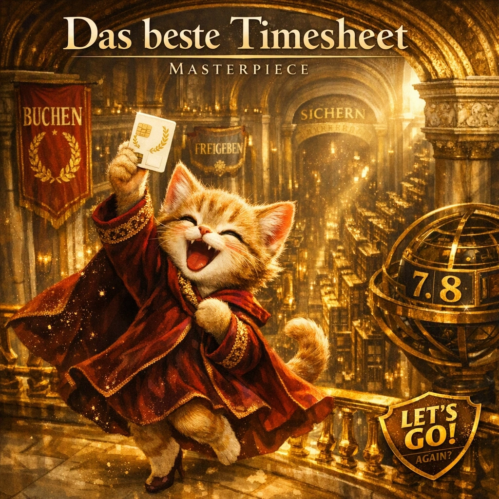

# *Symphonic Epic Pop* (Musikrichtung zu *Das beste Timesheet – 7,8*) 
 
#### Tracks & Workflow

[➜ Track 1 anhören](../audio/symphonic_epic_pop_1.mp3)
[➜ Track 2 anhören](../audio/symphonic_epic_pop_2.mp3)
[➜ Track 3 anhören](../audio/symphonic_epic_pop_3.mp3)
[➜ Track 4 anhören](../audio/symphonic_epic_pop_4.mp3)

[➜ ComfyUI_Workflow](../workflows/symphonic_epic_pop.json)

#### Genre-Cover & Bild-Prompt



```text
Square 1:1 symphonic crossover album cover, photorealistic cinematic still, epic trailer-music aesthetic, shot on 70mm, golden light rays, fine grain.
SCENE: High-angle wide shot from the golden gallery of an immense cathedral-like archive hall. Towering golden bookshelves far below, processional flags on stone pillars, glowing dust.
The kitten girl is large in the lower-left foreground, filling about 40% of the frame height, sharp and close to camera: a photorealistic small anthropomorphic kitten girl, petite and youthful, rounded fluffy kitten head, large ears with soft inner tufts, plush ginger-tabby fur. Oversized dark-crimson velvet robe with gold-embroidered cuffs and a trailing cape, standing on a golden balustrade. Three-quarter rear view, head turned back toward the camera, grand open-mouthed singing cheer, joyful squint. Mid-leap on tiptoes, ears perked, tail curled upward, gold dust around her. Right arm straight up holding an ivory SMARTCARD with gilded laurels and a white-gold chip; left arm bent at half height.
Palette: antique gold, dark crimson, marble white, midnight blue shadows.
Illuminated manuscript banners, near to far: "BUCHEN" largest on a crimson standard, "FREIGEBEN" on a tapestry, "SICHERN" smallest on the grand archway. Roman caps with gold leaf.
Mid-ground right: a brass mechanical calendar globe whose rings show "7.8" in gold leaf.
Typography: title "Das beste Timesheet" at top, classical serif, ivory with gold glow; subtitle "Masterpiece" in thin letterspaced caps; bottom-right tilted gold-foil crest badge "LET'S GO!", beneath it small semi-transparent "AGAIN?".
Mood: legendary, anthemic apotheosis, golden bloom.
Spell all text exactly as written, no additional text.
```

---

Zurück zur [➜ Übersicht der Musikrichtungen](styles.md) oder zurück zum [➜ Hauptdokument](../README.md).
