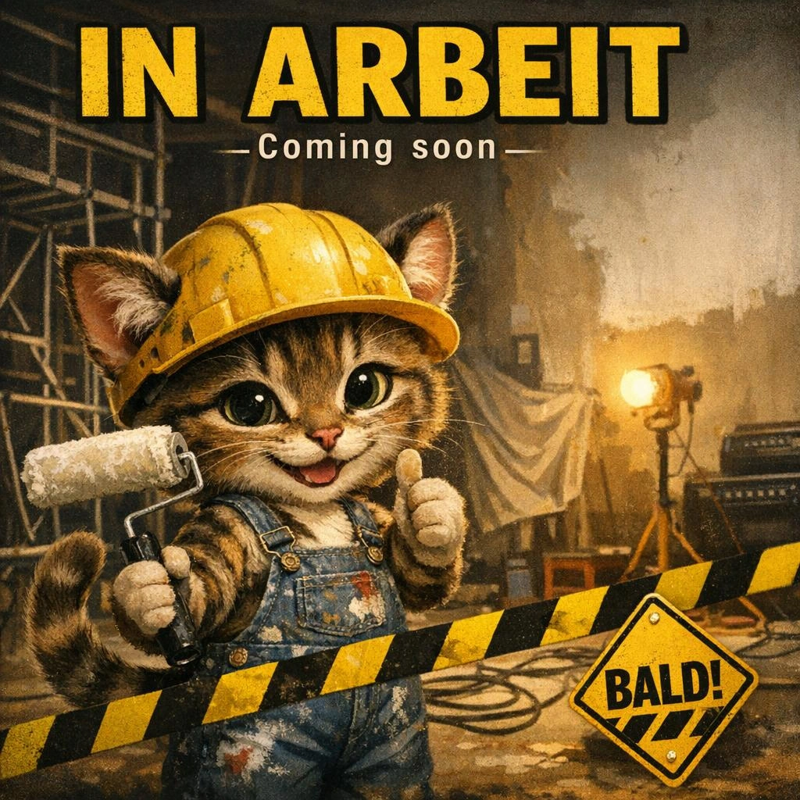

## In Arbeit

#### Tracks & Workflow

* *In Arbeit – Tracks und ComfyUI-Workflow folgen in Kürze.*

#### Genre-Cover & Bild-Prompt



```text
Square 1:1 album cover placeholder, photorealistic cinematic still, shot on 35mm, soft light bloom, fine film grain.
SCENE: A cozy, half-finished music studio under construction: scaffolding, a draped tarp, half-painted wall, cables on the floor, a single work lamp casting a warm pool of light, yellow-black caution tape across the frame.
The kitten girl is large in the lower-left foreground: a photorealistic small anthropomorphic kitten girl, petite and youthful, rounded fluffy kitten head, large ears with soft inner tufts poking through holes in an oversized yellow hard hat, plush short brindle fur. She wears oversized paint-splattered denim overalls. Three-quarter view, looking at the camera with a cheeky, determined grin, holding a paint roller in one paw and giving a thumbs-up with the other; tail curled upward.
Palette: safety yellow, charcoal black, warm work-lamp amber, soft cream.
Typography: large title "IN ARBEIT" at top, bold stencil sans-serif in safety yellow with black outline; below it smaller subtitle "Coming soon" in thin letterspaced caps, white. Bottom-right: a slightly tilted construction-sign style badge "BALD!" in bold caps.
Mood: playful, optimistic, work-in-progress.
Spell all text exactly as written, no additional text.
```

---

Zurück zur [➜ Übersicht der Musikrichtungen](styles.md) oder zurück zum [➜ Hauptdokument](../README.md).
