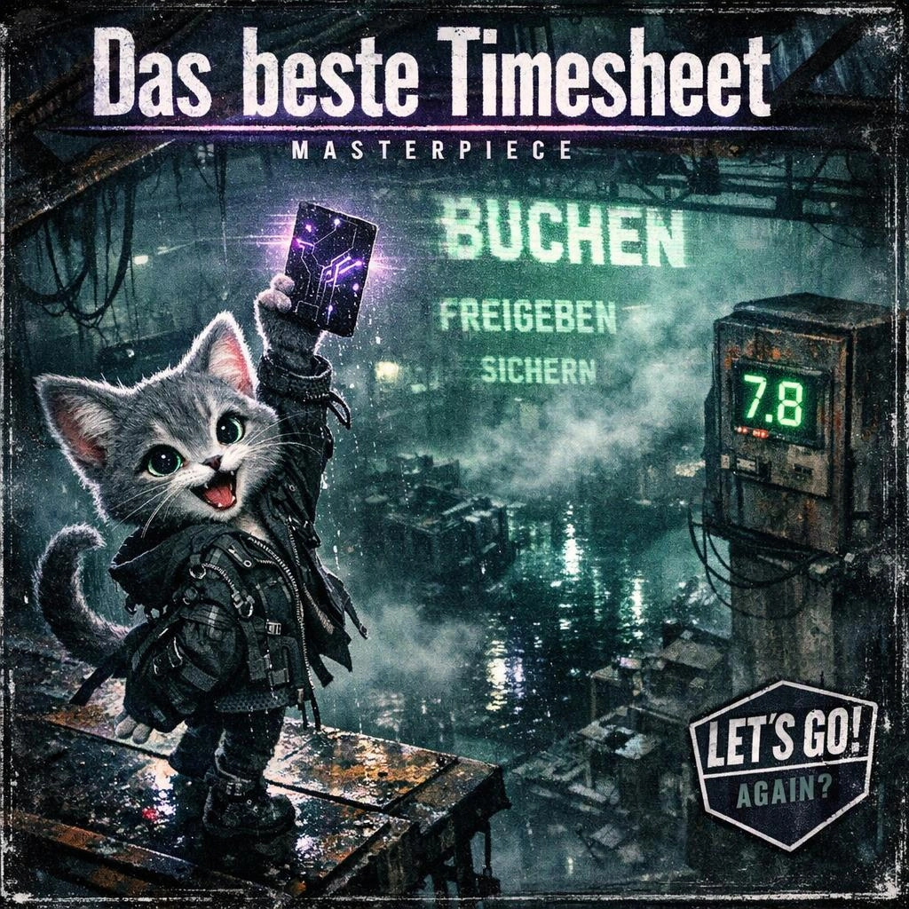

# *Witch House* (Musikrichtung zu *Das beste Timesheet – 7,8*) 

#### Tracks & Workflow

* [➜ Track 1 anhören](../audio/witch_house_1.mp3)
* [➜ Track 2 anhören](../audio/witch_house_2.mp3)
* [➜ Track 3 anhören](../audio/witch_house_3.mp3)
* [➜ Track 4 anhören](../audio/witch_house_4.mp3)
* [➜ ComfyUI_Workflow](../workflows/witch_house.json)

#### Genre-Cover & Bild-Prompt



```text
SCENE: An extreme wide, high-angle night shot from the rusting rafters of an abandoned, flooded industrial shipyard warehouse, camera positioned high and far back among broken corrugated metal sheets. Square 1:1 witch house 12" sleeve, photorealistic cinematic still, cyber-goth aesthetic, shot on 35mm, distorted wide-angle perspective, harsh glitch artifacts, heavy analog grain. Broken industrial machinery, a dark standing pool of water far below reflecting flashing glitch synths, a thick layer of industrial-shadowed fog.
A photorealistic small anthropomorphic kitten girl — petite and youthful, rounded fluffy kitten head with anatomically believable structure, large oversized ears with soft inner fur tufts, very soft plush short ash-grey fur — stands on the very edge of a rusting metal platform in the lower left corner of the frame, the wet, oil-slicked metal surface beneath her reflecting the flashing lights in realistic specular streaks. She wears an oversized tattered cyber-goth hoodie jacket covered in heavy safety pins and bondage straps, hood down, slightly too big for her small frame, physically accurate fabric drape. Her body is seen in a three-quarter rear view from behind. Her head is turned back over her shoulder toward the camera in a charming three-quarter view, both large bright pale eyes catching the cold light, mouth open in a half-spoken, rapid-fire talk-singing cheer, whiskers fanned, a joyful squint — a haunting expression against the dark setting. She is posed in pure euphoric, eerie excitement — mid-leap on tiptoes, back arched, ears perked straight up, tail whipping upward in an energetic curl, tiny droplets of toxic industrial drizzle flung off her fur by the motion and caught in crisp detail. Her RIGHT arm is stretched fully vertical above her head, presenting a SMARTCARD heroically aloft in her paw like a dark sigil — a matte-black distressed card with glowing ghostly purple geometric circuit lines, blindingly lit from within, casting hard practical light on her paw, forearm, jawline, and the surrounding fog. Her LEFT arm lags behind, bent at the elbow at half height, paw open.
Palette: industrial-shadowed textures — charcoal black, deep amethyst purple, cold zinc grey, flashing neon green highlights, no warmth whatsoever. Distorted digital projection beams onto the corrugated metal walls spell out a three-step sequence, staggered in depth from near to far: "BUCHEN" largest and closest with heavy scan-flicker, "FREIGEBEN" mid-distance partially occluded by steam, "SICHERN" smallest and deepest, blurred in the heavy fog. Corrupted, blocky sans-serif caps with glitch offsets.
Mid-ground center-right: a large, rusted industrial voltage breaker box on a concrete pillar; its glowing digital diagnostic screen clearly displays the error code numerals "7.8" in crisp, luminous neon-green glitching font.
Typography composited cleanly over the image: large title "Das beste Timesheet" across the top, stark condensed sans with subtle tracking distortion, bone white with a faint purple halo. Below it, smaller subtitle "Masterpiece" in thin letterspaced caps. Bottom-right: a slightly tilted inverted crest badge "LET'S GO!" in bold caps, and just beneath it, smaller and semi-transparent, "AGAIN?".
Mood: eerie, delirious, industrial underground euphoria. Cold strobe bloom, deep crushed shadows, heavy vignette, zero warm tones.
```

---

Zurück zur [➜ Übersicht der Musikrichtungen](styles.md) oder zurück zum [➜ Hauptdokument](../README.md).
